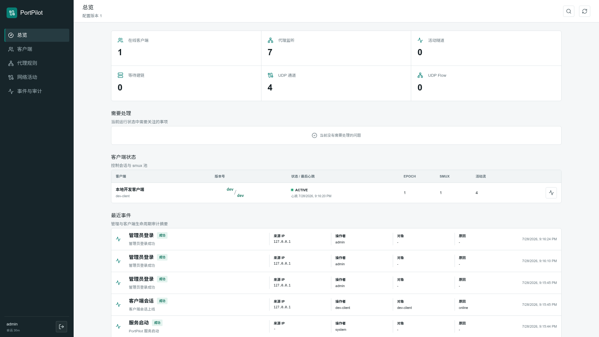
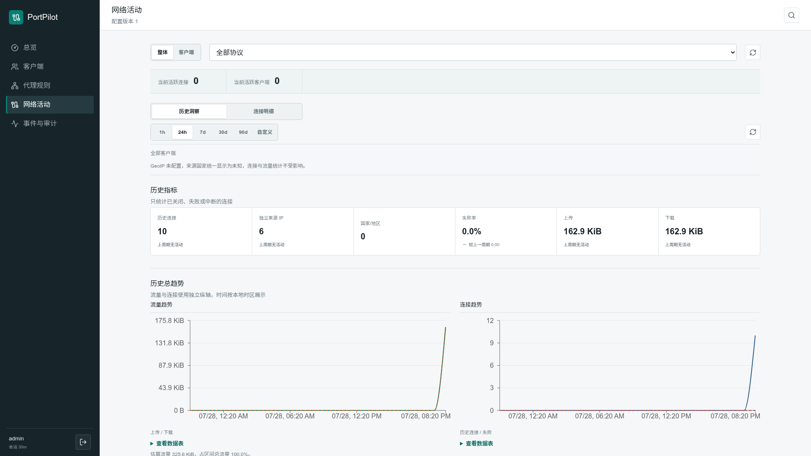
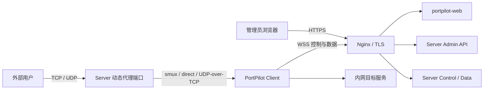

# PortPilot

[](https://github.com/xxxsen/portpilot/actions/workflows/ci.yml)
[](https://github.com/xxxsen/portpilot/actions/workflows/acceptance.yml)
[](https://github.com/xxxsen/portpilot/releases/latest)

PortPilot 是一个由服务端集中管理代理规则的内网反向代理工具。客户端只需配置服务端地址和
Token；代理目标、监听端口、访问控制、速率限制和临时访问授权均由管理后台统一管理。

它适合在公网服务器上暴露家庭网络、实验室或办公内网中的 TCP/UDP 服务，同时保留清晰的访问
控制、连接历史和审计信息。



<details>
<summary>查看网络活动与历史趋势</summary>



</details>

## 核心能力

| 能力 | 说明 |
| --- | --- |
| 集中配置 | 客户端不保存代理规则；管理员在服务端 Web 控制台管理客户端和代理 |
| TCP 与 UDP | TCP 使用 smux stream 或 direct 连接；UDP 在服务端与客户端之间封装为 UDP-over-smux/TCP |
| 连接复用 | 每个客户端维护可伸缩的 smux session 池，减少高并发场景中的重复建链 |
| 访问控制 | 支持全局和单代理 `private_only`、CIDR allow/deny 以及邮件 Magic Link 临时授权 |
| 流量治理 | 支持单连接上下行限速、TCP PROXY Protocol v1 和来源 IP 拒绝统计 |
| 可观测性 | 提供实时连接、历史连接、流量趋势、Top IP、国家/地区、事件审计和数据导出 |
| 可恢复存储 | 客户端与代理配置文件是事实来源；SQLite 和 GeoIP 缓存均可删除并重建 |
| 多架构镜像 | 正式镜像同时发布 `linux/amd64` 和 `linux/arm64/v8` |

## 工作方式



- Go 服务端不处理 TLS，生产 TLS 必须在 Nginx 边界终止。
- 管理 API 使用 `/api/`，不能在反向代理时移除该前缀。
- 客户端默认使用 `/portpilot/control`、`/portpilot/data/mux` 和
  `/portpilot/data/direct`。
- 动态代理端口由 `portpilot-server` 直接监听，不经过 Nginx。
- 控制连接与数据连接相互独立；控制流量不进入 smux。

## 快速体验

本地开发环境需要 Go 1.26、Node.js 24.22.1 或更新的 24.x 安全版本、npm、curl、jq 和 `ss`：

```bash
git clone https://github.com/xxxsen/portpilot.git
cd portpilot
make bootstrap
make doctor
make dev
```

启动完成后访问 <http://127.0.0.1:3000>，使用本地专用账号 `admin` / `admin` 登录。

`make dev` 启动真实的 Server、Client 和 Web，同时提供 TCP、UDP 和 SMTP 测试目标。它只用于
本地体验和开发，不应把 `configs/dev/` 中的账号、Token 或 SMTP 配置复制到生产环境。

可在另一个终端验证完整数据路径：

```bash
make smoke-dev
```

## 生产部署

PortPilot 发布三张 Docker Hub 镜像。生产环境应固定到明确版本，不建议长期使用 `latest`：

| 组件 | 镜像 |
| --- | --- |
| Server | [`xxxsen/portpilot-server`](https://hub.docker.com/r/xxxsen/portpilot-server) |
| Client | [`xxxsen/portpilot-client`](https://hub.docker.com/r/xxxsen/portpilot-client) |
| Web | [`xxxsen/portpilot-web`](https://hub.docker.com/r/xxxsen/portpilot-web) |

例如拉取 `v0.0.16`：

```bash
export PORTPILOT_VERSION=v0.0.16
docker pull "xxxsen/portpilot-server:${PORTPILOT_VERSION}"
docker pull "xxxsen/portpilot-client:${PORTPILOT_VERSION}"
docker pull "xxxsen/portpilot-web:${PORTPILOT_VERSION}"
```

推荐的单机部署方式是：

1. `portpilot-server` 使用 host 网络，使管理后台新增的动态代理端口可以立即对外监听。
2. `portpilot-web` 监听内部 `3000` 端口。
3. Nginx 负责公网 `443`、TLS、管理 API 以及客户端 WebSocket 转发。
4. 管理员首次登录后创建客户端并复制一次性展示的 Client Token。
5. 在内网机器启动 `portpilot-client`，再从管理后台创建代理规则。

完整命令、最小生产配置、目录权限、容器化 Nginx、升级和验证步骤见
[生产部署指南](docs/006-production-deployment.md)。

### 端口边界

| 端口/地址 | 用途 | 是否应直接暴露公网 |
| --- | --- | --- |
| `443/tcp` | Web、Admin API、客户端控制与数据入口 | 是 |
| `3000/tcp` | `portpilot-web` | 否 |
| `5100/tcp` | Server Admin API 与健康检查 | 否 |
| `6100/tcp` | Server 控制、smux 和 direct 入口 | 否 |
| 动态代理端口 | 外部用户访问内网服务 | 按代理规则决定 |

Nginx 必须保留以下路径：

| 外部路径 | 上游 |
| --- | --- |
| `/api/` | `admin_addr`，路径原样转发 |
| `/portpilot/control` | `server_addr` |
| `/portpilot/data/mux` | `server_addr` |
| `/portpilot/data/direct` | `server_addr` |
| `/` | `portpilot-web` |

经过校验的参考配置位于
[`docker/nginx/default.conf`](docker/nginx/default.conf)。

## 配置模型

PortPilot 使用三份 JSON 配置：

| 配置 | 所在位置 | 作用 |
| --- | --- | --- |
| Server 主配置 | 公网服务器 | 监听地址、管理员、缓存、日志、限额、GeoIP 和 Knock |
| 客户端与代理配置 | 公网服务器 | Client ID、Token 以及全部代理规则；Web 控制台会修改该文件 |
| Client 配置 | 内网机器 | 服务端地址、TLS、Client ID 和 Client Token |

所有 JSON 都使用严格解析，未知字段会导致启动失败。可在启动前验证：

```bash
portpilot-server validate-config --config /etc/portpilot/server.json
portpilot-client validate-config --config /etc/portpilot/client.json
```

生成管理员 bcrypt 密码哈希：

```bash
portpilot-server password-hash
```

服务端和客户端均使用 Cobra 子命令，正式启动命令为：

```bash
portpilot-server run --config /etc/portpilot/server.json
portpilot-client run --config /etc/portpilot/client.json
```

## 上线检查

- 使用 bcrypt cost 不低于 10 的管理员密码哈希。
- Client Token 使用至少 32 字节的随机数据，并限制配置目录访问权限。
- Nginx 已启用 TLS，并覆盖传入的 `X-Real-IP` 等真实来源 Header。
- `admin_addr` 和 `server_addr` 仅绑定 loopback 或受防火墙保护的内部地址。
- Docker 部署时，Server 使用 host 网络，或已明确映射全部可能的代理端口。
- `clients.json` 所在目录可写；不要把该文件作为只读的单文件 bind mount。
- `cache_dir` 可写且允许删除重建；真正需要备份的是 Server 和客户端/代理配置。
- 容器环境优先把日志输出到 console；使用文件日志时提前准备可写目录。
- 对公开代理配置 CIDR ACL、`private_only` 或邮件 Knock，不依赖端口隐蔽性。
- 客户端生产配置启用 TLS，并连接 Nginx 的公开地址而不是 Go 服务端明文端口。

## 常见问题

| 现象 | 优先检查 |
| --- | --- |
| 登录接口返回 404 | Nginx 是否把 `/api/` 原样转发到 `5100`，且没有移除 `/api` |
| 客户端一直离线 | `enable_tls`、域名证书、`/portpilot/*` 路由和 WebSocket Upgrade Header |
| 新增代理后外部端口不可达 | Server 是否使用 host 网络、`bind` 是否监听外部地址、主机防火墙是否放行 |
| ACL 获取到错误来源 IP | 动态代理端口只使用 socket peer；`real_ip_header` 不作用于代理端口 |
| `clients.json` 无法保存 | 挂载整个配置目录并保证运行 UID/GID 可写，避免只挂载单个文件 |
| 日志或缓存 permission denied | 检查挂载目录所有者；容器日志可直接使用 console |
| Web 显示客户端版本不一致 | Server 与 Client 应升级到同一正式版本 |

更多部署排障见 [生产部署指南](docs/006-production-deployment.md#12-排障)。

## 文档

| 文档 | 内容 |
| --- | --- |
| [整体设计](docs/001-portpilot-design.md) | 架构、协议、认证、生命周期、ACL、smux 和 UDP |
| [管理后台与 CLI](docs/002-admin-console-and-cli-improvements.md) | Web API、审计、迁移、CLI 和配置事务 |
| [网络历史分析](docs/003-network-history-analytics.md) | 历史聚合、Top IP、GeoIP 和数据保留 |
| [运行洞察](docs/004-operational-insights-and-navigation.md) | 运行状态、搜索、对比、导出和缓存布局 |
| [邮件临时授权](docs/005-email-magic-link-knock.md) | SMTP、Magic Link、授权生命周期和安全边界 |
| [生产部署](docs/006-production-deployment.md) | Docker、Nginx、权限、启动、升级和排障 |
| [CVE-2026-111497](docs/007-cve-2026-111497.md) | Web Node.js/Brotli 影响范围与运行时升级 |

## 开发与贡献

常用门禁：

```bash
make ci
```

面向 `master` 的 Pull Request 会同时执行确定性 CI 和完整 acceptance。acceptance 会启动真实
Server、Client 和 Web，执行 smoke、浏览器 E2E、故障注入以及 15 分钟并发 soak：

```bash
make acceptance
```

Tag 发布只构建并发布三张 `linux/amd64`、`linux/arm64/v8` 镜像，不重复执行 soak。

PortPilot 当前仍处于 `v0.x` 阶段。升级前请阅读
[Release Notes](https://github.com/xxxsen/portpilot/releases)，配置和协议在 `v1.0` 前仍可能演进。
