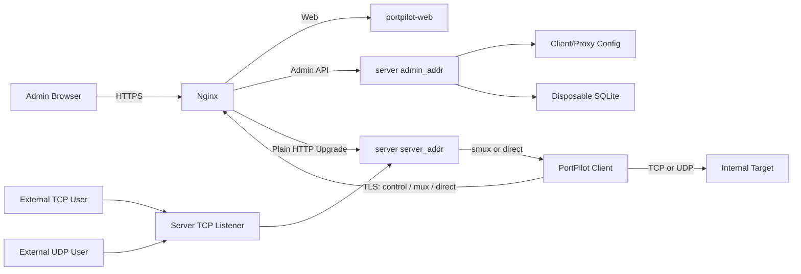
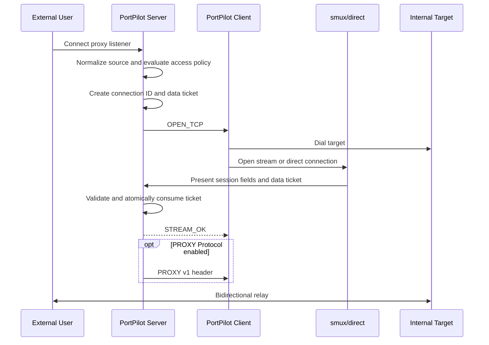

# PortPilot 架构与协议设计

## 1. 文档定位

PortPilot 是一个由服务端集中管理代理规则、由客户端访问内网目标的反向代理系统。

本文记录已经落地且需要长期保持的架构、协议、安全和运行时契约。管理后台、审计、连接活动、
SQLite migration 和 CLI 的详细契约见
[`002-admin-console-and-cli-improvements.md`](002-admin-console-and-cli-improvements.md)，历史聚合、
Top K、GeoIP 和 IP 下钻见
[`003-network-history-analytics.md`](003-network-history-analytics.md)，运行可见性、搜索、周期对比、
导出和 cache 生命周期见
[`004-operational-insights-and-navigation.md`](004-operational-insights-and-navigation.md)。具体默认参数以配置
校验器和仓库配置示例为准；工程门禁以 `Makefile` 和 `AGENTS.md` 为准。

核心边界：

- 服务端和客户端使用 Go。
- 管理后台使用 Next.js、React、TypeScript 和 Tailwind CSS。
- 客户端只保存服务端地址、连接路径、客户端 ID 和 token，不保存代理规则。
- 客户端身份和代理规则以独立配置文件为事实来源。
- SQLite 只保存可丢弃的访问、流量和审计数据。
- Go 服务端不处理 TLS；生产 TLS 终止在 Nginx。
- 控制连接独立于 smux，代理数据不进入控制连接。
- TCP 数据支持 smux 和 direct；UDP 使用 UDP-over-smux/TCP。

## 2. 系统拓扑

### 2.1 组件

PortPilot 由以下正式组件组成：

- `portpilot-server`：管理客户端身份、代理配置、listener、控制会话、数据会话和中继。
- `portpilot-client`：主动连接服务端，接收建链信令并访问内网目标。
- `portpilot-web`：管理客户端、代理配置、运行状态和审计信息。
- Nginx：终止外部 TLS，并把 Web、管理 API、控制连接和数据连接转发到对应内部服务。
- SQLite：保存不影响代理恢复的观测数据。

生产和开发都使用 `cmd/portpilot-server` 与 `cmd/portpilot-client` 两个正式入口，不存在替代版测试服务端或客户端。

### 2.2 部署关系



Nginx 的职责：

- 证书、TLS 版本、SNI 和证书续期。
- 对外路径重写、Upgrade header 转发和入口限流。
- 将 Web 页面转发给 `portpilot-web`。
- 将管理 API 转发给服务端 `admin_addr`。
- 将控制和数据 Upgrade 转发给服务端 `server_addr`。

Go 服务端的职责：

- `admin_addr` 提供管理 API 和健康检查。
- `server_addr` 接收控制、smux 和 direct 连接。
- 动态代理端口由服务端直接监听，不经过 Nginx。
- `admin_addr` 和 `server_addr` 应绑定 loopback 或受保护的内部地址。

Nginx 到 Go 服务端是可信明文链路。若两者不在同一主机，必须通过隔离网络和防火墙限制来源。

### 2.3 单一客户端入口

客户端通过一个外部地址连接 Nginx，内部使用三条稳定路由：

| 路由 | 连接用途 | 承载内容 |
| --- | --- | --- |
| `<path>/control` | 长期 WebSocket | 鉴权、心跳和信令 |
| `<path>/data/mux` | HTTP Upgrade 后的双向字节流 | 一条 smux session |
| `<path>/data/direct` | HTTP Upgrade 后的双向字节流 | 一条 direct TCP 隧道 |

三种用途共享物理入口，但使用独立 TCP 连接、读写循环和资源限制。

控制连接不能进入 smux。这样数据拥塞、底层 TCP 丢包或某条 smux session 故障不会占用控制连接的应用发送队列，也不会阻塞心跳与调度。

## 3. 配置模型

### 3.1 配置分层

PortPilot 使用三类配置：

| 配置 | 所有者 | 内容 |
| --- | --- | --- |
| 服务端主配置 | 服务端 | 管理/数据监听地址、管理员、代理配置路径、cache 根目录、数据面参数、超时、限额和日志 |
| 客户端与代理配置 | 服务端 | 客户端 ID、token、启停状态和代理规则 |
| 客户端运行配置 | 客户端 | 服务端地址、TLS、外部路径、客户端 ID、token 和日志 |

客户端与代理配置文件是代理运行状态的事实来源。删除 SQLite 后，服务端仍必须能从配置文件恢复 listener 并等待客户端重连。

所有 JSON 使用严格解析。未知字段、非法枚举、重复 ID、重复端口和不完整地址必须导致校验失败，不能静默使用零值。

### 3.2 服务端主配置

主配置包含以下稳定字段组：

| 字段 | 语义 |
| --- | --- |
| `admin_addr` | 管理 API 和健康检查监听地址 |
| `server_addr` | 控制、smux 和 direct 入口监听地址 |
| `real_ip_header` | Admin 与客户端控制入口读取真实来源的 HTTP header；空值回退 socket peer |
| `users` | 管理员账号和 bcrypt password hash |
| `client_config_file` | 客户端与代理配置文件路径 |
| `cache_dir` | SQLite、远程 GeoIP 等可重建派生数据的易失缓存根目录 |
| `access_policy` | 动态代理端口的全局外部来源 CIDR allow/deny |
| `data_plane` | transport、smux pool 和 UDP 参数 |
| `timeouts` | 握手、心跳、建链、空闲和最长生命周期 |
| `limits` | pending、tunnel、session、flow、消息和速率上限 |
| `log_config` | 服务端日志级别、console/file 输出和文件轮转参数 |

`data_plane.smux` 由服务端权威配置，并在客户端鉴权成功后下发。客户端不能通过本地配置放宽 stream、buffer、keepalive、drain 或 session 上限。

目标建链、TCP 空闲和 TCP 最长生命周期同样由服务端下发并由客户端执行。

### 3.3 客户端与代理配置

结构示例：

```json
{
  "revision": 1,
  "client_config": [
    {
      "client_id": "office-a",
      "client_token": "<random-secret>",
      "remark": "Office A",
      "enabled": true,
      "created_at": 1784449800000,
      "updated_at": 1784449800000,
      "proxy_list": [
        {
          "proxy_id": "office-a-ssh",
          "remark": "Office SSH",
          "kind": "tunnel",
          "enabled": true,
          "data": {
            "network": "tcp",
            "transport": "auto",
            "bind": ":7000",
            "connect": "192.168.50.11:22",
            "enable_proxy_protocol": true,
            "access_policy": {
              "allow_cidrs": ["203.0.113.0/24"],
              "deny_cidrs": ["203.0.113.128/25"]
            },
            "rate_limit": {
              "up_bytes_per_second": 1048576,
              "down_bytes_per_second": 4194304
            }
          }
        },
        {
          "proxy_id": "office-a-dns",
          "remark": "Office DNS",
          "kind": "tunnel",
          "enabled": true,
          "data": {
            "network": "udp",
            "transport": "smux-datagram",
            "bind": ":7053",
            "connect": "192.168.50.53:53"
          }
        }
      ]
    }
  ]
}
```

稳定约束：

- `client_id` 全局唯一；`proxy_id` 在所属客户端内唯一，代理完整标识为 `(client_id, proxy_id)`，
  且不依赖数组下标。
- `client_token` 必须由密码学安全随机数生成，不能使用短口令。
- `remark` 是客户端的必填可读名称。
- `created_at` 和 `updated_at` 是服务端权威的 Unix 毫秒时间戳。
- `kind` 由服务端进行强类型分派；未知类型拒绝。
- `network` 只允许 `tcp` 或 `udp`。
- TCP transport 为 `auto`、`smux` 或 `direct`。
- UDP transport 固定为 `smux-datagram`。
- `bind` 和 `connect` 使用结构化 host/port 解析。
- 代理端口在服务端范围内全局唯一，并且不能与管理和数据入口冲突。
- `access_policy` 只限制连接代理端口的外部 socket 来源；全局与代理 allow 取交集，任意
  deny 优先。
- `rate_limit` 按每条 TCP 连接或每个 UDP flow 分别限制上行与下行 payload bytes/s，零值
  表示不限速。
- `enable_proxy_protocol` 缺省关闭，只允许 TCP；启用后目标必须接受 PROXY Protocol v1。

配置查询 API 只能返回脱敏 token。token 轮换时，新 token 只展示一次；配置文件仍属于敏感文件。

### 3.4 客户端运行配置

```json
{
  "server": "portpilot.example.com:443",
  "enable_tls": true,
  "tls_ca_file": "",
  "path": "/portpilot",
  "client_id": "office-a",
  "client_token": "<random-secret>",
  "log_config": {
    "level": "info",
    "console": true
  }
}
```

- `server` 指向 Nginx，不直接暴露 Go 服务端。
- 公网环境必须启用 TLS 并验证证书链和服务端名称。
- `tls_ca_file` 用于私有 CA；不存在跳过证书验证的配置。
- 禁用 TLS 只适用于本机开发或受保护专网，并应产生明确告警。
- `path` 可以降低无意探测，但不是安全边界。
- 客户端本地不保存 proxy、smux 或 UDP 参数。
- `log_config` 与服务端使用相同结构；客户端和服务端独立初始化、独立输出。

## 4. 身份与鉴权

### 4.1 控制连接挑战应答

控制连接使用 `client_id + client_token` 派生的 HMAC 挑战应答，不发送明文 token：

1. 客户端发送 `AUTH_INIT`，包含 `client_id`、连接角色、客户端随机数和可选 Agent 信息。
2. 服务端返回一次性随机 challenge、challenge ID 和过期时间。
3. 双方通过 HKDF-SHA256 从 token 和 client ID 派生认证密钥。
4. 客户端对包含协议域、client ID、角色、challenge 和 nonce 的规范字符串计算 HMAC-SHA256。
5. 服务端使用恒定时间比较签名并原子消费 challenge。
6. 成功后服务端创建 `session_id` 并分配新的 `session_epoch`。

签名使用固定协议域分隔不同用途。鉴权失败统一返回 `AUTH_FAILED`，不得暴露客户端是否存在、禁用或签名错误。

HMAC 只证明客户端持有 token，不提供加密，因此客户端到 Nginx 的 TLS 仍然是生产必需项。

### 4.2 控制会话

每个 `client_id` 只有一个 current control session：

- 新合法会话采用 newest-wins。
- `session_epoch` 在每次替换时单调递增。
- 旧会话立即失去创建 mux、stream、direct connection 和 UDP flow 的资格。
- 已建立数据流按 drain 策略结束。
- 管理员主动断开或凭据泄露处置可以立即关闭全部数据流。

所有已认证控制消息都校验 `session_id` 和 `session_epoch`。

新客户端在 Agent 中上报构建版本、commit、Go 版本、OS/arch、主机名、进程启动时间、协议
版本和实际能力。服务端只在 token 鉴权完成后发布该信息；它只用于资产展示、兼容判断和审计，
不参与授权。旧客户端可不发送 Agent。服务端 PING 使用唯一 request ID，客户端 PONG 原样
返回，服务端以本地单调时钟计算控制 RTT。

### 4.3 数据面一次性票据

长期 token 只参与控制连接挑战应答。数据面使用短期一次性票据：

| 票据 | 用途 | 绑定对象 |
| --- | --- | --- |
| `mux_ticket` | 建立一条底层 smux session | client、session、epoch、mux ID |
| `data_ticket` | 建立 TCP smux stream 或 direct 隧道 | client、session、epoch、connection ID、transport |
| `udp_channel_ticket` | 建立 UDP channel stream | client、session、epoch、proxy ID、channel ID |

票据必须：

- 使用密码学安全随机数生成。
- 只在服务端保存哈希。
- 设置短有效期。
- 按预期角色和绑定字段验证。
- 原子消费，拒绝重放。
- 在 session epoch 失效后不可使用。

底层 mux 已认证不代表其所有 stream 自动可信。每个 TCP stream 和 UDP channel 都必须验证自己的票据。

### 4.4 管理后台鉴权

管理后台和客户端使用不同认证域：

- 管理员配置只保存符合成本要求的 bcrypt hash。
- 登录后创建服务端随机 session。
- Cookie 使用 `HttpOnly`、`Secure` 和严格 SameSite 策略。
- 所有管理写请求需要 CSRF 校验。
- 登录同时按来源和账号限流。
- 登录时从 10 分钟、30 分钟、1 小时和 24 小时中选择绝对有效期；访问 API 不滑动续期。
- 登录、退出、配置更新、token 轮换、代理启停和主动断开写入审计。

## 5. 应用协议

### 5.1 控制消息

控制面使用有大小上限的 JSON envelope：

```json
{
  "version": 1,
  "type": "OPEN_TCP",
  "request_id": "<request-id>",
  "session_id": "<session-id>",
  "session_epoch": 7,
  "sequence": 42,
  "payload": {}
}
```

字段语义：

- `version`：协议版本；未知主版本拒绝。
- `type`：消息类型。
- `request_id`：请求幂等和响应关联。
- `session_id`、`session_epoch`：控制会话身份。
- `sequence`：会话内递增序号。
- `payload`：按消息类型强类型解码。

消息分组：

- 鉴权：`AUTH_INIT`、`AUTH_CHALLENGE`、`AUTH_PROOF`、`AUTH_OK`、`AUTH_ERROR`。
- 存活：`PING`、`PONG`。
- smux：`CREATE_MUX_SESSION`、`MUX_SESSION_READY`、`MUX_DRAIN`、`MUX_CLOSED`。
- TCP：`OPEN_TCP`、`OPEN_RESULT`、`CANCEL_TUNNEL`、`TUNNEL_CLOSED`。
- UDP：`OPEN_UDP_CHANNEL`、`UDP_CHANNEL_READY`、`UDP_CHANNEL_CLOSED`。
- 生命周期：`SESSION_REPLACED`、`SERVER_DRAIN`、`ERROR`。

### 5.2 数据连接前置帧

HTTP Upgrade 成功后，mux 和 direct 连接先交换长度前缀 JSON 帧：

```text
uint32 big-endian length + JSON payload
```

smux 底层连接前置帧包含：

- role `mux`
- client ID
- session ID 和 epoch
- mux ID
- mux ticket

服务端验证并返回 `MUX_OK` 后，双方才初始化 smux。

TCP smux stream 的首帧包含：

- role `tcp-stream`
- client、session、epoch 和 mux ID
- connection ID
- data ticket

direct connection 使用相同的 connection ID 和 data ticket，但 role 为 `direct`，不包含 mux ID。

服务端在分配内存前校验长度上限。读取前置帧必须保留 reader 已经预读的后续字节，不能丢失紧随其后的 smux 或隧道数据。

### 5.3 稳定错误分类

协议向对端返回稳定机器码，内部原因只写脱敏日志。主要分类包括：

- 鉴权失败和旧 session。
- mux ticket、data ticket 和 UDP channel ticket 无效。
- mux session 丢失或达到上限。
- 客户端离线或目标建链失败。
- 资源上限和配置 revision 冲突。
- 内部错误。

未认证阶段不返回可用于枚举身份的细分原因。

## 6. smux 数据面

### 6.1 连接池

客户端认证成功后，服务端下发数据面能力和权威参数，并签发 mux ticket。客户端建立 `/data/mux` 连接并完成前置认证，然后双方初始化 smux。

连接池行为：

- 至少维持配置的最小 session 数。
- 按活动 stream 和队列压力扩展到上限。
- 新 stream 选择健康、非 draining 且负载较低的 session。
- 高于最小值且长期空闲的 session 通过 drain 缩容。
- 达到最大年龄或需要维护时，session 停止接收新 stream，已有 stream 完成后关闭。
- pool、buffer、stream 和全局 session 数都受配置上限约束。

单个客户端不能依赖一条无限承载的底层连接。多个 smux session 用于限制 TCP head-of-line blocking 和单连接故障范围。

### 6.2 direct transport

TCP transport 的语义：

- `direct`：每条隧道建立独立 `/data/direct` 连接。
- `smux`：只允许 smux；池不可用时建链失败。
- `auto`：优先 smux，在允许 direct fallback 且没有健康 mux 时为新隧道使用 direct。

回退只适用于新隧道。已建立 TCP 字节流不能在 smux 和 direct 之间迁移或从中间位置重试。

### 6.3 故障与 drain

- 一条 smux session 丢失只关闭该 session 上的 stream。
- 控制连接和其他 mux session 继续运行。
- pool 通过有界退避补足健康 session。
- draining session 不再接受新 stream。
- 活动 stream 归零后正常关闭；超过 drain timeout 后强制关闭。
- smux keepalive 只检测数据连接，控制存活仍由独立心跳负责。

## 7. TCP 隧道

### 7.1 建链流程



服务端接受外部连接后：

1. 读取不可变 proxy 配置快照。
2. 使用 socket `RemoteAddr` 检查全局和代理外部来源策略。
3. 检查客户端状态和资源上限。
4. 创建 pending tunnel、connection ID 和 data ticket。
5. 通过控制连接发送目标、transport、deadline 和 ticket。
6. 客户端先连接内网目标，再建立 smux stream 或 direct 数据连接。
7. 服务端验证数据首帧并与外部连接配对。
8. 按建链时配置写入可选 PROXY Protocol v1 header 后进入 payload 中继。

### 7.2 中继语义

- 双向复制必须保留 backpressure。
- 一侧 EOF 后使用 half-close 通知另一侧，同时允许反向剩余数据完成。
- 建链、空闲和最长生命周期由服务端策略限制。
- 目标拒绝、reset、数据连接超时和 session 丢失都必须结束对应隧道并释放资源。
- 流量统计异步写入，不能阻塞数据路径。
- 上下行 limiter 位于服务端 relay 层，每条连接独立，因此 smux、direct 和 fallback 语义
  一致；限速只计算成功转发的 payload。

客户端离线或没有可用数据面时，新 TCP 连接快速失败，不在服务端无限排队等待重连。

### 7.3 外部来源策略

全局和代理策略都使用 canonical IPv4/IPv6 CIDR。来源先去端口和 IPv6 zone，再对
IPv4-mapped IPv6 执行 unmap。允许条件是来源不命中任意 deny，并满足每个非空 allow 列表；
解析失败时 fail closed。TCP 在 activity、ticket 和信令创建前判定，UDP 在 flow 查找前对
每个 datagram 判定。

代理策略提交后，新请求立即使用新快照；不再允许的 pending/active TCP 和 UDP flow 以
`source_policy_changed` 关闭，UDP 同时向客户端发送 `FLOW_CLOSE`。来源拒绝写结构化日志、
并按 network/proxy/reason 写精确的进程聚合指标；重复日志按来源和规则限频，不写审计或
为每次扫描创建连接明细。

动态代理端口始终使用四层 socket peer，不读取 `real_ip_header`。

### 7.4 PROXY Protocol v1

启用时，服务端在外部 TCP accept 时冻结 socket source/destination，并生成 `PROXY TCP4` 或
`PROXY TCP6` 文本 header。header 在 `STREAM_OK` 之后、`Activity.Connected` 和首个用户
payload 之前完整写入已鉴权数据流；构造或写入失败关闭两端并记录
网络活动失败状态和结构化错误日志。header 不消耗限速 token，也不计入流量、采样或历史聚合。
开关更新只影响提交后接受的新连接，不在活跃字节流中插入或撤回 header。

## 8. UDP-over-TCP

### 8.1 语义

UDP 路径为：

```text
External User -- UDP --> PortPilot Server
PortPilot Server -- datagram frame over smux/TCP --> PortPilot Client
PortPilot Client -- UDP --> Internal Target
```

两端边缘保持标准 UDP socket，中间链路通过 TCP 可靠有序传输：

- PortPilot frame 保留 datagram 边界。
- TCP 丢包会阻塞同一底层连接上的后续 datagram。
- 中间链路不保留原生 UDP 的丢包和乱序特征。
- PortPilot 队列满时主动丢包并计数，不无限阻塞 UDP listener。
- 每个 flow 有独立上下行 token bucket；token 不足只丢当前 datagram，并单独累计限速丢包
  和字节，不阻塞共享 channel。

因此该能力应明确标识为 UDP-over-TCP，而不是原生 UDP 隧道。

### 8.2 UDP channel

每个在线 UDP 代理维持有界的专用 smux channel stream：

1. 服务端发送 `OPEN_UDP_CHANNEL` 和一次性 channel ticket。
2. 客户端选择健康 mux 并打开 stream。
3. stream 首帧提交 session、proxy、channel 和 ticket。
4. 服务端验证并注册 channel。
5. channel 只传输 UDP datagram frame。

同一 UDP flow 固定映射到同一 channel，避免 PortPilot 自身造成重排。channel 丢失后可以重建，但在途 datagram 不做应用层重放。

### 8.3 Datagram frame

UDP 使用网络字节序二进制帧：

```text
+---------+------+-------+---------+----------+----------+-------------+
| Version | Type | Flags | Flow ID | Addr Len | Data Len | Addr + Data |
| 1 byte  | 1 B  | 2 B   | 8 B     | 2 B      | 4 B      | variable    |
+---------+------+-------+---------+----------+----------+-------------+
```

frame type：

- `DATA_TO_CLIENT`：包含外部来源地址和原始 UDP payload。
- `DATA_TO_SERVER`：通过 flow ID 返回目标响应。
- `FLOW_CLOSE`：主动释放 flow。

解析器使用完整读取语义处理 TCP 任意分片，并在分配内存前校验版本、类型、地址长度、payload 长度和总帧上限。

### 8.4 Flow 映射

服务端维护：

```text
(client_id, session_epoch, proxy_id, external_source) -> flow_id, channel_id
(client_id, session_epoch, proxy_id, flow_id) -> external_source
```

客户端维护：

```text
(client_id, session_epoch, proxy_id, flow_id) -> UDP socket connected to target
```

处理规则：

- 服务端根据外部来源查找或创建 flow。
- 客户端为新 flow 创建连接目标的 UDP socket。
- 响应只能通过服务端保存的 flow 映射返回外部来源。
- 客户端不能在响应帧中指定任意公网目标。
- 任一方向活动刷新 flow TTL。
- epoch 切换后为继续发包的来源创建新 flow，旧 flow 只 drain 在途响应。
- 每代理和全局 flow 数、channel 队列及 datagram 大小都有上限。
- channel 不可用、队列已满或 flow 达到上限时丢弃并记录稳定原因。

## 9. Listener、Session 与配置生命周期

### 9.1 状态分离

运行态必须分为不同所有权域：

```text
DesiredConfig    client_id + proxy_id -> immutable ProxySpec
ListenerRegistry client_id + proxy_id -> TCP/UDP ListenerHandle
SessionRegistry  client_id -> current ActiveSession
MuxRegistry      client_id + epoch + mux_id -> Active/Draining MuxSession
TunnelRegistry   connection/channel/flow -> Pending or Active runtime
```

配置、listener、控制会话、mux 和 tunnel 不能混在一个 map 中，也不能由同一个生命周期统一清理。

### 9.2 客户端断线

控制连接断开时：

- 仅当 registry 仍指向该 session 时移除 current session。
- 停止心跳、控制写队列和新建链调度。
- 取消未完成的 TCP tunnel 和 UDP channel。
- 使该 epoch 未消费票据失效。
- 将旧 mux 和 UDP channel 置为 draining。
- 拒绝旧 epoch 的晚到消息和新数据流。

不得删除：

- 客户端与代理配置。
- DesiredConfig。
- ListenerRegistry。
- SQLite 历史记录。

离线期间 TCP 新连接快速失败；UDP 新 datagram 丢弃并计数。系统不能无限缓存请求等待客户端上线。

### 9.3 重连与重复登录

客户端重连只替换 SessionRegistry 并创建新 epoch 的数据面，不直接调用 `net.Listen`：

1. 在单个临界区递增 epoch。
2. 原子替换 current session。
3. 旧 session 进入 draining。
4. 新 session 建立自己的 mux pool 和 UDP channel。
5. 新请求只进入新 epoch。

该规则避免双活，也避免因重连重复监听代理端口。

### 9.4 Listener reconcile

所有监听变化统一通过配置 reconcile：

- proxy ID、network 和 bind 未变化：复用 listener。
- 只修改目标、备注或 transport：更新配置快照，不重新 bind。
- 新增代理：预绑定新 listener，成功后发布。
- 删除或禁用代理：停止接收新请求，按策略 drain 后关闭。
- 修改 network 或 bind：先绑定新地址，成功后再切换和关闭旧地址。

已经建立的 TCP tunnel 保持建链时的目标、transport 和 PROXY Protocol 开关。代理来源策略
与上下行限速会 reconcile 到活跃 TCP/UDP；已有 UDP flow 使用原目标直到 TTL。

### 9.5 原子配置更新

配置更新同时使用：

- 进程内写锁。
- 稳定 sidecar lock file 的操作系统文件锁。
- API `revision` 乐观并发控制。
- 同目录临时文件和原子 rename。

更新顺序：

```text
authorize
  -> acquire locks
  -> read current revision
  -> compare expected revision
  -> strict decode and semantic validation
  -> compute listener diff
  -> pre-bind changed listeners
  -> fsync temp file and atomic rename
  -> fsync parent directory
  -> publish immutable config snapshot
  -> install/drain listeners
  -> release locks
```

revision 不匹配返回 conflict。校验、预绑定或写文件失败时继续使用旧文件和旧运行态。磁盘提交后若发布运行态失败，服务端进入 degraded 并按磁盘配置重新 reconcile。

### 9.6 服务端重启

服务端启动顺序：

1. 严格加载主配置和客户端配置。
2. 执行 SQLite migrations、完整性检查和旧库重建。
3. 恢复 pending 审计和未结束网络活动，并补全旧客户端元数据。
4. 构建 DesiredConfig。
5. reconcile TCP/UDP listener。
6. 启动管理和控制/数据入口。
7. 等待客户端重连并重建 session、mux 和 UDP channel。

session、ticket、tunnel、channel 和 flow 是易失运行态，不从 SQLite 恢复。

## 10. 状态机与资源治理

主要状态机：

```text
Client: DISCONNECTED -> CONNECTING -> AUTHENTICATING
        -> DATA_PLANE_CONNECTING -> ACTIVE/DEGRADED
        -> DRAINING -> DISCONNECTED

Mux:    CONNECTING -> AUTHENTICATING -> ACTIVE -> DRAINING -> CLOSED

TCP:    ACCEPTED -> WAIT_CLIENT -> WAIT_DATA -> RELAYING -> DRAINING -> CLOSED

UDP:    CHANNEL_CONNECTING -> ACTIVE -> DRAINING -> CLOSED
        FLOW_NEW -> ACTIVE -> EXPIRED/CLOSED
```

资源不变量：

- 每个控制连接只有一个 socket 写循环，并使用有界写队列。
- 管理器不能在持有全局锁时执行网络 I/O。
- 每个 tunnel、channel 和 flow 都有独立 context、deadline 和清理路径。
- goroutine、pending tunnel、mux、stream、flow、buffer 和 queue 都有配置上限。
- 未认证连接使用更短超时、更小帧上限和独立限流。
- 客户端重连使用带 jitter 的有界指数退避。
- SQLite 队列满或不可写不能阻塞数据面。

## 11. SQLite、审计与可观测性

### 11.1 SQLite 边界

SQLite 可以保存：

- 连接开始、结束、持续时间和关闭原因。
- client、proxy 和脱敏来源标识。
- 上下行字节和 datagram 统计。
- 当前限速、TCP 累计等待、UDP 限速丢包和 PROXY Protocol 发送状态。
- 客户端 Agent、控制来源和最近上线/离线快照。
- 管理操作、配置变更、客户端身份/会话和系统生命周期审计。
- 可重建聚合指标。

SQLite 不能保存：

- 代理配置事实来源。
- client token。
- current session、mux、ticket、tunnel、channel 或 flow。
- 服务端启动必需且无法从配置恢复的数据。

数据库不存在时自动重建。数据库不可写时观测能力进入 degraded，现有代理配置和数据面继续运行。

### 11.2 日志与指标

客户端和服务端使用 `github.com/xxxsen/common/logger` 初始化日志，并通过
`logutil.GetLogger(ctx)` 获取携带上下文的 Zap logger。两端配置结构一致：

| 字段 | 语义 |
| --- | --- |
| `level` | `panic`、`fatal`、`error`、`warn`、`info` 或 `debug` |
| `console` | 是否输出到标准错误 |
| `file` | 可选日志文件；相对路径以当前进程的配置文件目录为基准 |
| `file_size` | 单个日志文件的轮转阈值，单位为字节；启用 `file` 时必须大于 0 |
| `file_count` | 最多保留的轮转文件数，`0` 表示不按数量清理 |
| `keep_days` | 最多保留天数，`0` 表示不按时间清理 |

省略整个 `log_config` 时，默认使用 `debug` 级别并输出到 console。配置存在时至少启用
console 或 file 之一；日志文件的父目录由进程创建。客户端和服务端不应配置为写入同一个
文件。`level` 为空时统一规范化为 `debug`，命令行不提供独立的日志级别覆盖参数。

生产环境建议使用 `info` 或更高级别，并由进程日志采集器接管 console；需要本地文件时再
显式配置轮转。业务日志使用稳定消息和结构化字段，不通过字符串拼接承载上下文。

结构化日志可以包含：

- request、connection、client 和 proxy 标识。
- session ID 的短前缀和 epoch。
- transport、持续时间、字节数和关闭原因。

不得包含 token、完整 ticket、signature、密码、session cookie 或 CSRF token。

关键指标：

- 客户端 ACTIVE、DEGRADED、DRAINING 分布。
- mux session、活动 stream、扩缩容和异常关闭。
- TCP pending/active、建链延迟、transport 和关闭原因。
- UDP channel、flow、datagram、队列水位和丢弃原因。
- 外部来源拒绝按 network、proxy 和原因的连接数、datagram 数及字节数。
- 鉴权失败、ticket 重放、配置 revision 和 listener reconcile。
- goroutine、文件描述符和内存使用。

健康状态区分：

- live：进程可响应。
- ready：核心配置和入口可用。
- degraded：SQLite、部分 client/mux 或观测能力异常，但不等于进程死亡。

## 12. 管理后台

管理后台提供以下稳定能力：

- 管理员登录、当前会话和退出。
- 客户端在线状态、epoch、mux 和 stream 状态。
- 客户端备注、创建/修改时间及代理配置的查询和 revision-safe 更新。
- TCP smux、TCP direct 和 UDP-over-TCP 代理配置。
- 外部来源 CIDR、每连接双向限速和 TCP PROXY Protocol v1 配置。
- 客户端 Agent、运行环境、控制来源、心跳 RTT 和最近离线原因。
- 总览客户端状态直接展示最后心跳；点击客户端打开同一套详情 Drawer。
- 总览客户端状态提供网络活动图标入口，并携带客户端筛选条件。
- client token 一次性轮换和旧会话失效。
- 主动断开客户端。
- 整体/客户端网络活动、连接生命周期、上下行流量和详情。
- 可筛选、分页、展示操作者 IP、包含脱敏上下文和配置差异的事件与审计。
- 运行时聚合指标。

所有服务端写接口同时要求管理员 session 和 CSRF。配置写入使用 expected revision，冲突时由调用方刷新后重新决策，不能覆盖他人的更新。

Web 前端的校验、脱敏和权限显示不能替代服务端校验。

## 13. 安全不变量

- 生产客户端和浏览器只通过 Nginx TLS 访问。
- Go 服务端不加载证书或私钥。
- `real_ip_header` 只用于 Admin 和客户端控制 HTTP 入口；配置后信任列表第一项，Nginx 必须
  覆盖同名 header。缺失、空值或非法值回退规范化 `RemoteAddr`。
- 原始 TCP/UDP 代理端口只使用 socket peer，并执行全局和代理外部来源策略。
- 动态代理端口透明转发；业务加密由 SSH、HTTPS 等上层协议负责。
- token、challenge、ticket 和 session 使用密码学安全随机数。
- HMAC 使用安全散列并恒定时间比较。
- challenge 和所有 ticket 短期有效、绑定用途、原子消费且防重放。
- 管理端使用 bcrypt、CSRF、安全 Cookie、限流和审计。
- PROXY Protocol 来源只取外部代理 socket，不能使用 HTTP header 或客户端自报值。
- 所有控制、认证和数据帧在内存分配前验证长度与类型。
- 发布镜像使用 Alpine 运行层且不固化 `USER`；Go 二进制必须以 `CGO_ENABLED=0` 构建，
  并在镜像构建阶段执行兼容性探针。生产配置文件仅允许部署服务账号读取。
- secret 不进入日志、API 查询、Web 持久化存储或测试工件。

## 14. 工程与验收契约

### 14.1 正式入口与开发环境

- 服务端和客户端只有两个正式命令入口。
- `make dev` 启动正式 server、client、Web 和作为内网目标的 echo fixture。
- smoke、E2E、fault 和 soak 都连接同一套 `make dev` 进程。
- fixture 不能实现 PortPilot 信令、鉴权、smux 或中继。

### 14.2 质量门禁

稳定门禁层级：

| 命令 | 目的 |
| --- | --- |
| `make lint` | Go、Web、Shell、配置、Nginx 和 Dockerfile 静态检查 |
| `make test` | Go 单元测试 |
| `make test-race` | Go race detector |
| `make integration-test` | loopback socket 和跨模块协议测试 |
| `make web-test` | Web 单元测试 |
| `make web-e2e` | 真实 Web、server 和 client 的用户流程 |
| `make smoke-dev` | API、Web、TCP smux、TCP direct 和 UDP-over-TCP 快速全链路 |
| `make fault-test` | session、ticket、frame、目标和资源故障 |
| `make soak-test` | 并发、控制轮换、数据完整性和资源回收 |
| `make ci` | 确定性构建、lint、unit、race、Web 和 integration 汇总 |
| `make acceptance` | 面向 `master` 的 PR 创建或更新时执行完整验收和 15 分钟 soak |

没有单元测试覆盖率百分比阈值，但安全、协议和生命周期路径必须具备正常、错误和边界测试。

### 14.3 镜像边界

仓库只构建三个正式镜像：

- `portpilot-server`
- `portpilot-client`
- `portpilot-web`

Makefile 不提供 Docker/Compose 运行、容器 smoke 或容器测试目标。镜像只验证发布制品可以构建；
所有功能正确性由 `make dev` 启动的正式进程验证。面向 `master` 的 PR 创建或更新时，
`make ci` 与 `make acceptance` 作为两项独立门禁并行执行；直接 push `master` 只执行
确定性 CI。正式版本 tag 只构建并发布三张镜像，不重复执行 soak；每个版本标签发布
`linux/amd64` 和 `linux/arm64/v8` 的多架构 manifest。Makefile 的 `--load` 构建保持单平台，
通过 `IMAGE_PLATFORM` 选择架构，本地 ARMv8 镜像必须使用独立标签以免覆盖 amd64 镜像，且
Docker daemon 必须已经注册 ARM64 QEMU/binfmt；Tag 发布工作流负责自动初始化 QEMU。

## 15. 设计决策摘要

### 为什么控制和数据不拆物理端口

单一 Nginx 入口便于部署，三条路由和独立 TCP 连接已经提供生命周期及读写隔离。需要不同 QoS 时可以在部署层映射到不同内部地址，而不改变协议同步键。

### 为什么控制不进入 smux

控制心跳和调度不能被大流量 stream 的拥塞或底层 session 故障拖住。独立控制连接也是 newest-wins 和数据面补池的协调基础。

### 为什么使用 smux pool

少量长期 TCP/TLS/Upgrade 连接承载大量逻辑 stream，避免每个代理连接重复建链；多个底层 session 同时限制 head-of-line blocking 和单连接故障范围。

### 为什么保留 direct

direct 为显式隔离、诊断和 `auto` 模式下新隧道回退提供完整路径，但不尝试迁移已经建立的 TCP 字节流。

### 为什么 listener 不跟随客户端会话

listener 来源于服务端 DesiredConfig，而 session 是可替换的易失运行态。分离所有权才能保证客户端断线和重连不丢配置、不重复 bind。

### 为什么 UDP 选择 UDP-over-TCP

该模式保持两端 UDP 接口并复用现有出站 TCP/TLS 通道，代价是中间链路具有 TCP 的可靠有序和 head-of-line blocking 语义。通过独立 channel、flow 映射和有界队列控制影响范围。

### 为什么 SQLite 必须可丢弃

代理恢复只依赖配置文件。把 session、ticket 或代理规则写入 SQLite 会让观测存储变成数据面单点，并使删除数据库破坏现有代理。
