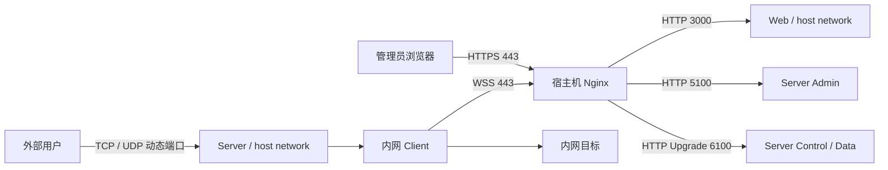

# PortPilot 生产部署

本文给出原生 Linux Docker Engine 上的单机 PortPilot 生产部署基线，覆盖 Server、Web、Nginx、
Client、目录权限、验证、升级和排障。TLS 始终由 Nginx 终止，Go Server 不处理入站 TLS。

Docker Desktop for macOS/Windows 的 host networking 与原生 Linux 不完全相同。桌面环境只用于
体验时可以使用 bridge 和显式端口映射；生产环境应以本文的 Linux 网络边界为准。

## 1. 推荐拓扑

推荐在公网 Linux 主机上使用 host 网络运行 Server 和 Web，并由宿主机 Nginx 提供公网入口：



Server 使用 host 网络的原因是代理监听端口由管理员动态创建，Docker bridge 无法预先枚举并
发布所有端口。`3000`、`5100` 和 `6100` 应只允许本机或受保护的内部网络访问。

以下命令以 Docker、宿主机 Nginx 和版本 `v0.0.17` 为例。升级部署时将版本变量替换为目标
[Release](https://github.com/xxxsen/portpilot/releases)。

从 `v0.0.16` 起，Server 和 Client 镜像使用 `golang:1.26.10-alpine` 编译，包含针对 eMudhra 中间 CA 私钥泄露
事件的 `crypto/x509` 证书链拦截修复（[CVE-2026-111943](https://github.com/golang/go/issues/82348)）。
该修复编译在 Go 二进制中，旧镜像必须重新构建并替换正在运行的容器；仅更新宿主机 CA
证书包或重启旧容器不会更新其 Go 证书校验逻辑。自行编译时应使用 Go 1.26.10 或更新的安全版本。

从 `v0.0.17` 起，Web 镜像使用 `node:24.22.1-alpine`，包含 CVE-2026-111497 的 Brotli 解码器修复。
此前基于 Node.js 20.19.2 构建的 Web 镜像必须重新构建并替换容器；重启旧容器或仅升级 npm
依赖不会替换其 Node.js 运行时。影响范围与核查依据见
[CVE-2026-111497 核查记录](007-cve-2026-111497.md)。

## 2. 准备目录

```bash
export PORTPILOT_VERSION=v0.0.17
export PORTPILOT_ROOT=/opt/portpilot

sudo install -d -m 0750 \
  "${PORTPILOT_ROOT}/config" \
  "${PORTPILOT_ROOT}/cache" \
  "${PORTPILOT_ROOT}/client"
sudo chown -R "$(id -u):$(id -g)" "${PORTPILOT_ROOT}"
```

目录职责：

```text
/opt/portpilot/
├── config/
│   ├── server.json       # Server 主配置
│   └── clients.json      # Web 控制台管理，必须可原子替换
├── cache/                # SQLite 和 GeoIP 等可重建数据
└── client/
    └── client.json       # 内网 Client 使用，实际通常位于另一台机器
```

不要把 `clients.json` 单独挂载成一个 bind mount。服务端更新配置时需要在同一目录写临时文件并
执行原子替换，应挂载整个 `config/` 目录。

## 3. 生成管理员密码

```bash
docker run --rm -it \
  "xxxsen/portpilot-server:${PORTPILOT_VERSION}" \
  password-hash
```

将输出的 bcrypt 哈希写入下一节的 `password_hash`。不要把明文密码写入配置。

## 4. 创建 Server 配置

创建 `/opt/portpilot/config/server.json`：

```json
{
  "admin_addr": "127.0.0.1:5100",
  "server_addr": "127.0.0.1:6100",
  "real_ip_header": "X-Real-IP",
  "users": [
    {
      "user_name": "admin",
      "password_hash": "<替换为上一节生成的 bcrypt 哈希>"
    }
  ],
  "client_config_file": "./clients.json",
  "cache_dir": "/var/lib/portpilot/cache",
  "log_config": {
    "level": "info",
    "console": true
  }
}
```

未显式配置的 timeout、limit、smux、UDP 和数据保留字段使用代码内的生产默认值。Server 使用
严格 JSON 解析，替换哈希时不要保留尖括号或添加注释。

创建空的客户端/代理配置：

```bash
printf '%s\n' '{"revision":1,"client_config":[]}' \
  >"${PORTPILOT_ROOT}/config/clients.json"
chmod 0640 "${PORTPILOT_ROOT}/config/server.json"
chmod 0640 "${PORTPILOT_ROOT}/config/clients.json"
```

验证配置：

```bash
docker run --rm \
  --user "$(id -u):$(id -g)" \
  -v "${PORTPILOT_ROOT}/config:/etc/portpilot" \
  -v "${PORTPILOT_ROOT}/cache:/var/lib/portpilot/cache" \
  "xxxsen/portpilot-server:${PORTPILOT_VERSION}" \
  validate-config --config /etc/portpilot/server.json
```

## 5. 启动 Server 与 Web

Server：

```bash
docker run -d \
  --name portpilot-server \
  --restart unless-stopped \
  --network host \
  --user "$(id -u):$(id -g)" \
  -v "${PORTPILOT_ROOT}/config:/etc/portpilot" \
  -v "${PORTPILOT_ROOT}/cache:/var/lib/portpilot/cache" \
  "xxxsen/portpilot-server:${PORTPILOT_VERSION}"
```

Web：

```bash
docker run -d \
  --name portpilot-web \
  --restart unless-stopped \
  --network host \
  "xxxsen/portpilot-web:${PORTPILOT_VERSION}"
```

容器内使用 console 日志，避免额外的文件日志权限问题。需要文件日志时，应把完整日志目录挂载
到容器，并确保运行 UID/GID 对目录可写。

检查本机入口：

```bash
curl -fsS http://127.0.0.1:5100/health/live
curl -fsS http://127.0.0.1:5100/health/ready
curl -fsS http://127.0.0.1:3000 >/dev/null
```

## 6. 配置 Nginx

复制 [`docker/nginx/default.conf`](../docker/nginx/default.conf) 并替换：

- `server_name`
- `ssl_certificate`
- `ssl_certificate_key`

关键路由必须保持：

```nginx
location = /portpilot/control {
    proxy_pass http://127.0.0.1:6100;
    proxy_http_version 1.1;
    proxy_set_header Connection "upgrade";
    proxy_set_header Upgrade $http_upgrade;
    proxy_set_header X-Real-IP $remote_addr;
    proxy_buffering off;
}

location ~ ^/portpilot/data/(mux|direct)$ {
    proxy_pass http://127.0.0.1:6100;
    proxy_http_version 1.1;
    proxy_set_header Connection "upgrade";
    proxy_set_header Upgrade $http_upgrade;
    proxy_set_header X-Real-IP $remote_addr;
    proxy_request_buffering off;
    proxy_buffering off;
}

location ^~ /api/ {
    proxy_pass http://127.0.0.1:5100;
    proxy_set_header X-Real-IP $remote_addr;
}

location / {
    proxy_pass http://127.0.0.1:3000;
}
```

`/api/` 必须原样转发，不能通过 rewrite 移除 `/api`。完整参考配置还包含 TLS、HSTS、请求限频、
Knock 邮件接口限频和合理的 WebSocket timeout，应优先使用完整文件。

验证并重载：

```bash
sudo nginx -t
sudo systemctl reload nginx
```

## 7. 创建并启动 Client

1. 访问 `https://portpilot.example.com`。
2. 使用 Server 配置中的管理员账号登录。
3. 进入“客户端”，创建客户端并立即保存一次性展示的 Client Token。
4. 在内网机器创建 Client 配置。

在内网机器重新声明版本和目录并准备配置目录：

```bash
export PORTPILOT_VERSION=v0.0.17
export PORTPILOT_ROOT=/opt/portpilot

sudo install -d -m 0750 "${PORTPILOT_ROOT}/client"
sudo chown -R "$(id -u):$(id -g)" "${PORTPILOT_ROOT}/client"
```

`/opt/portpilot/client/client.json`：

```json
{
  "server": "portpilot.example.com:443",
  "enable_tls": true,
  "tls_ca_file": "",
  "path": "/portpilot",
  "client_id": "<管理后台创建的 Client ID>",
  "client_token": "<管理后台一次性展示的 Client Token>",
  "log_config": {
    "level": "info",
    "console": true
  }
}
```

验证并启动：

```bash
docker run --rm \
  -v "${PORTPILOT_ROOT}/client/client.json:/etc/portpilot/client.json:ro" \
  "xxxsen/portpilot-client:${PORTPILOT_VERSION}" \
  validate-config --config /etc/portpilot/client.json

docker run -d \
  --name portpilot-client \
  --restart unless-stopped \
  --network host \
  -v "${PORTPILOT_ROOT}/client/client.json:/etc/portpilot/client.json:ro" \
  "xxxsen/portpilot-client:${PORTPILOT_VERSION}"
```

Client 使用 host 网络可以访问内网机器的 loopback 服务；如果代理目标全部是独立 LAN 地址，也
可以使用 bridge 网络。

## 8. 创建代理并验证

在管理后台进入“代理规则”，选择已经在线的客户端并创建规则。例如：

```text
协议：TCP
服务端监听：0.0.0.0:7000
客户端连接：192.168.50.11:22
传输：auto
```

然后从外部机器验证：

```bash
nc -vz portpilot.example.com 7000
ssh -p 7000 user@portpilot.example.com
```

如果端口只允许私网、固定 CIDR 或邮件临时授权，应先从符合策略的来源验证。动态代理端口直接
读取 TCP/UDP socket peer，不使用 `real_ip_header`。

本文使用非 root UID/GID 运行 Server，因此代理监听端口应使用 `1024` 及以上。确实需要监听
特权端口时，应显式授予 `NET_BIND_SERVICE` capability，并同时评估宿主机端口冲突和安全边界。

## 9. 容器化 Nginx

当 Nginx 运行在 Docker bridge、Server 运行在 host 网络时，在 Nginx 服务中增加：

```yaml
extra_hosts:
  - "portpilot-host:host-gateway"
```

`extra_hosts` 只添加静态 hosts 映射，不要求 PortPilot 已经启动，因此不会阻止 Nginx 启动。

Server 必须允许来自 Docker bridge 的连接。可以监听 `0.0.0.0:5100` 和 `0.0.0.0:6100`，
同时使用宿主机防火墙禁止公网直接访问这两个端口。

Nginx 上游使用固定 `proxy_pass`：

```nginx
proxy_pass http://portpilot-host:5100;
proxy_pass http://portpilot-host:6100;
```

不要使用下面这种变量形式：

```nginx
set $upstream "http://portpilot-host:5100";
proxy_pass $upstream;
```

变量形式会把域名解析推迟到请求阶段，并依赖 Nginx `resolver`；Docker 写入 `/etc/hosts` 的
`host-gateway` 名称可能因此返回 `Host not found`。

Web 可以和 Nginx 保持在同一个 bridge 网络，使用：

```nginx
proxy_pass http://portpilot-web:3000;
```

## 10. 权限和持久化

| 路径 | 要求 | 是否需要备份 |
| --- | --- | --- |
| `server.json` | 运行账号可读 | 是 |
| `clients.json` 所在目录 | 运行账号可读写并允许原子替换 | 是 |
| Client `client.json` | 运行账号可读 | 是 |
| `cache_dir` | 运行账号可读写 | 否，可删除重建 |
| 文件日志目录 | 启用文件日志时可读写 | 按运维需求 |

容器默认以 root 启动。若希望配置文件保持宿主机普通用户所有权，像本文一样使用
`--user "$(id -u):$(id -g)"`，并确保配置、缓存和日志目录都属于同一 UID/GID。不要只解决
`clients.json` 的权限而遗漏 `cache_dir` 或文件日志目录。

## 11. 升级与回滚

升级前备份配置目录：

```bash
sudo tar -C "${PORTPILOT_ROOT}" -czf \
  "portpilot-config-$(date +%Y%m%d%H%M%S).tar.gz" config client
```

拉取同一版本的三张镜像，先升级 Server 和 Web，再升级 Client。Client 会自动重连；总览中的
版本列应显示 Server 与 Client 版本一致。

SQLite 位于 `cache_dir`，属于可重建的观测数据，不是代理配置事实来源。回滚时恢复旧镜像和
配置目录即可；是否保留 cache 取决于是否需要历史连接与审计记录。

## 12. 排障

### 登录接口 404

- 检查浏览器请求是否为 `/api/auth/login`。
- 检查 Nginx 是否把 `/api/` 原样转发到 `admin_addr`。
- 不要 rewrite 成 `/auth/login`。

### Client 无法上线

- 确认 `enable_tls: true`，域名和证书匹配。
- 确认 `/portpilot/control` 和 `/portpilot/data/*` 支持 HTTP Upgrade。
- 确认 `server` 包含端口，例如 `portpilot.example.com:443`。
- 查看 Server 与 Client console 日志中的认证、版本和 session 错误。

### 动态代理端口无法访问

- 确认 Server 使用 host 网络。
- 确认代理 `bind` 不是 `127.0.0.1:<port>`。
- 确认宿主机防火墙和云安全组已放行对应 TCP 或 UDP 端口。
- 检查全局 ACL、代理 ACL 和 `allow_knock_only`。

### `clients.json` 无法保存

- 挂载整个配置目录，不要只挂载单个文件。
- 检查运行 UID/GID 是否可以在目录中创建临时文件并执行 rename。
- Server 启动后可在管理后台执行一次配置修改进行验证。

### 日志或 cache permission denied

- 容器环境优先启用 console 日志。
- 文件日志、配置目录和 `cache_dir` 必须同时对运行 UID/GID 可写。
- 不要依赖镜像内 `/tmp` 或未挂载路径保存需要保留的内容。

### ACL 中的来源 IP 不符合预期

- Admin、公开 Knock 和客户端 HTTP 入口可以使用 `real_ip_header`。
- 动态代理端口始终使用 socket peer，不能从 TCP/UDP 负载中读取 HTTP Header。
- 如果代理端口前还有四层负载均衡，应重新评估来源 IP 保留方式。

### GeoIP 未加载

- `observability.geoip_country_source` 可以是本地 MMDB 文件或 HTTPS 地址。
- 远程文件下载到 `cache_dir`，默认每 7 天检查更新。
- GeoIP 不影响连接和流量统计，只影响国家/地区展示。
