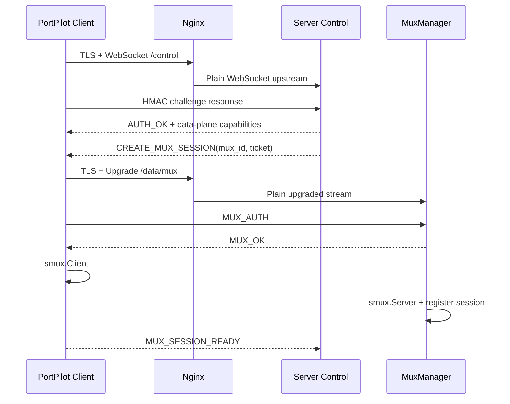
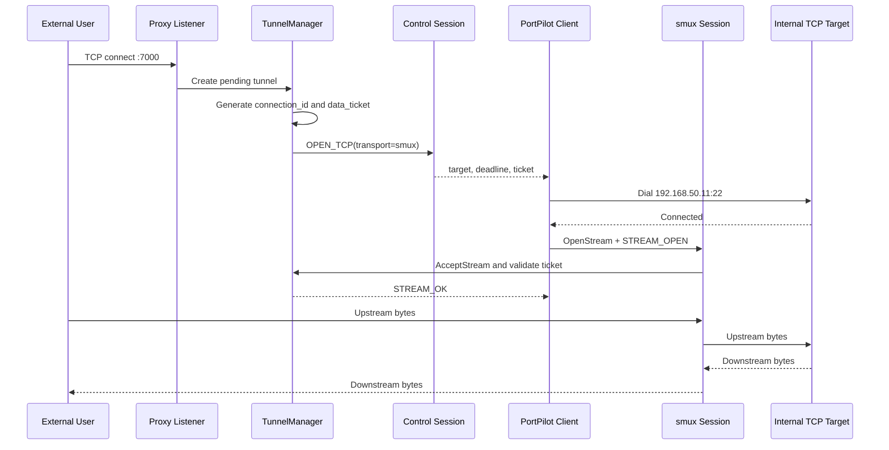

# PortPilot 方案设计

## 1. 目标与边界

PortPilot 是一个由服务端集中管理代理规则、客户端负责访问内网目标的反向代理工具。

- 服务端和客户端均使用 Go。
- 服务端管理后台使用 Next.js、React 和 Tailwind CSS，代码位于服务端工程的 `web` 目录。
- 代理配置以独立配置文件为真源。
- SQLite 只保存流量、访问和审计等可重建数据，删除数据库不能影响代理配置。
- 客户端只配置服务端地址、外部路径、`client_id` 和 `client_token`，不在客户端本地保存代理规则。
- **Go 服务端不处理 TLS，也不加载证书。服务端固定部署在 Nginx 后面，由 Nginx 终止 TLS。**

本文描述 PortPilot 的完整目标方案。TCP、UDP-over-TCP、smux 数据面、direct 回退、管理后台、配置一致性、安全、可观测性和故障恢复均属于正式方案范围；实施顺序只用于降低交付风险，不代表任何能力被留作未定义的后续事项。

## 2. 核心结论

1. Nginx 对外只暴露一个客户端信令/数据入口，Go 服务端只监听一个 `server_addr`；控制和数据依靠 HTTP 路由及 Upgrade 角色区分。
2. 控制面和数据面逻辑分离。控制连接始终独立，不放入 smux，也不承载代理数据。
3. TCP 数据面默认使用 smux 连接池：少量长期底层 TCP 连接承载多条逻辑 stream，避免为每条代理连接重复建立 TCP、TLS 和 HTTP Upgrade。
4. direct 数据连接是正式回退能力，用于显式配置为 direct 的代理、smux 池不可用时的新连接和故障诊断。
5. 单个客户端不能只依赖一条 smux session。连接池从 1 条起步，按负载扩展到配置上限，以控制 TCP head-of-line blocking 和单连接故障范围。
6. TCP 隧道使用 `connection_id + data_ticket` 逐 stream 配对；smux 底层连接另用一次性 `mux_ticket` 认证。
7. UDP 正式采用 UDP-over-TCP：外部用户和内网目标两端使用 UDP，服务端与客户端之间把每个 UDP datagram 封装成有界二进制帧，并通过专用 smux stream 池传输。
8. UDP-over-TCP 保留 datagram 边界和 flow 映射，但底层 TCP 的可靠有序传输会引入 head-of-line blocking；这是选定方案的明确语义，不把它描述成原生 UDP。
9. 代理监听器属于服务端配置运行态，不属于客户端会话。客户端断线、重连不得无条件重复调用 `net.Listen`。
10. 客户端断线时清理控制会话、mux session、未完成隧道和票据，不删除代理配置；代理监听器保持运行，离线期间的新请求快速失败。
11. 每个 `client_id` 只允许一个活跃控制会话。新的合法连接替换旧连接，并递增 `session_epoch`。
12. 客户端认证使用强随机 `client_token` 派生的 HMAC 挑战应答。客户端到 Nginx 必须使用 TLS；Nginx 到 Go 服务端只允许可信明文链路。

## 3. 部署拓扑

```text
 Admin Browser -------- TLS ------+
 PortPilot Client ----- TLS ------+--> Nginx
                                        |
                                        | trusted plaintext upstream
                                        v
                           +-----------------------------+
 External TCP User -----> |      PortPilot Server       |
              :7000       |                             |
                           | Web/API      admin_addr     |
                           | Control + smux server_addr  |
                           | Proxy        :7000 ...      |
                           |                             |
                           | Config / Listener / Session |
                           | Tunnel / Relay / SQLite     |
                           +-----------------------------+
                                         ^
                                         |
                              client outbound connection
                                         |
                           +-----------------------------+
                           | Internal Target             |
                           | 192.168.50.11:22             |
                           +-----------------------------+
```

TLS 职责边界：

- 客户端和浏览器只与 Nginx 建立 TLS。
- Nginx 负责证书、SNI、TLS 版本、证书续期、外部路径和公网限流。
- Go 服务端只处理 Nginx 转发后的明文 HTTP、WebSocket 或 Upgrade 数据流。
- Go 服务端配置中不出现证书、私钥或 TLS 开关。
- `admin_addr` 和 `server_addr` 默认绑定 `127.0.0.1`，防止绕过 Nginx 直连。
- Nginx 与服务端不在同一主机时，服务端只监听受保护的内网地址，并通过防火墙仅允许 Nginx 来源。
- 由代理配置动态创建的 `:7000` 等业务监听端口由 Go 服务端直接监听，不经过 Nginx；否则每次新增端口都需要同步更新 Nginx stream 配置。
- PortPilot 对业务连接保持透明，不为外部用户到代理端口的流量额外增加 TLS。SSH、HTTPS 等上层协议仍使用自身的加密。

## 4. 服务端模块

- `ConfigManager`：读取、校验、加锁、原子更新代理配置。
- `ListenerManager`：根据配置对 TCP/UDP 监听器进行幂等协调。
- `SessionManager`：维护 `client_id -> ActiveSession`。
- `MuxManager`：认证、注册、调度、扩缩容和 drain 客户端 smux session。
- `TunnelManager`：维护待建链、待配对和中继中的 TCP 隧道。
- `UDPFlowManager`：维护外部 UDP 来源与客户端 flow 的双向映射和 TTL。
- `AuthService`：客户端 HMAC 鉴权和管理后台鉴权。
- `Relay`：TCP 双向复制、UDP frame 转发、半关闭、超时和流量统计。
- `EventStore`：异步写入 SQLite。
- `Web/API`：为管理后台提供配置、状态、会话和审计接口。

客户端模块：

- `ControlClient`：连接 Nginx、鉴权、心跳和断线重连。
- `CommandDispatcher`：处理服务端建链、mux 管理、取消和下线指令。

- `MuxPool`：维护 1 到 N 条 smux session、选择低负载 session 并执行 drain。
- `Dialer`：连接目标内网地址和 Nginx 数据入口。
- `Relay`：在内网 TCP 连接与 smux stream/direct 数据连接之间双向复制。
- `UDPRelay`：维护目标 UDP socket、flow 生命周期和 datagram frame 编解码。

## 5. 配置设计

### 5.1 服务端主配置

以下为严格 JSON 示例，正式配置不允许注释：

```json
{
  "admin_addr": "127.0.0.1:5100",
  "server_addr": "127.0.0.1:6100",
  "trusted_proxies": [
    "127.0.0.1/32"
  ],
  "users": [
    {
      "user_name": "abc",
      "password_hash": "$2b$12$..."
    }
  ],
  "client_config_file": "./conf/clients.json",
  "data_db": "./data/portpilot.db",
  "target_policy": {
    "allow_cidrs": ["10.0.0.0/8", "172.16.0.0/12", "192.168.0.0/16"],
    "deny_cidrs": [],
    "allow_ports": [],
    "deny_ports": []
  },
  "data_plane": {
    "default_transport": "auto",
    "direct_fallback": true,
    "smux": {
      "protocol_version": 2,
      "min_sessions": 1,
      "max_sessions": 4,
      "max_streams_per_session": 128,
      "scale_up_streams": 96,
      "session_max_age": "1h",
      "drain_timeout": "5m",
      "keepalive_interval": "20s",
      "keepalive_timeout": "60s",
      "max_frame_size": 32768,
      "max_receive_buffer": 4194304,
      "max_stream_buffer": 524288
    },
    "udp": {
      "channels_per_proxy": 2,
      "flow_idle_timeout": "60s",
      "max_flows_per_proxy": 4096,
      "max_datagram_size": 65507,
      "channel_queue_datagrams": 1024
    }
  },
  "timeouts": {
    "control_handshake": "10s",
    "heartbeat_interval": "20s",
    "heartbeat_timeout": "60s",
    "target_dial": "10s",
    "data_connect": "15s",
    "tcp_idle": "10m",
    "tcp_max_lifetime": "24h"
  },
  "limits": {
    "max_pending_tunnels": 1024,
    "max_tunnels_per_client": 256,
    "max_control_message_bytes": 65536,
    "max_data_handshakes_per_minute": 60000,
    "max_admin_login_attempts_per_minute": 10,
    "max_mux_sessions_total": 4096,
    "max_udp_flows_total": 65536
  }
}
```

说明：

- `admin_addr`：管理 API 和 Next.js 服务入口，由 Nginx 反代。
- `server_addr`：客户端控制、smux 和 direct 数据连接的明文内部入口，由 Nginx 反代。
- `trusted_proxies`：允许传递真实来源信息的 Nginx 地址。
- `target_policy`：对客户端可访问的内网目标执行 CIDR/端口 allowlist 与 denylist；启用 CIDR 规则时 `connect` 必须使用 IP 字面量，deny 规则优先。
- `data_plane.default_transport`：`auto`、`smux` 或 `direct`。代理规则省略 `transport` 时继承该值；显式填写 `auto` 时保持 `auto`。`auto` 优先 smux；`direct_fallback=true` 时允许新隧道 direct 回退。
- `data_plane.smux`：服务端权威参数，通过控制连接下发；客户端不增加本地参数。
- `data_plane.udp`：UDP-over-TCP 的 channel、flow、队列和 datagram 上限。
- `timeouts.target_dial`、`tcp_idle` 和 `tcp_max_lifetime` 由服务端通过 `AUTH_OK` 下发并由客户端执行，防止受控端自行放宽目标建链、空闲和最长生命周期限制。
- `limits.max_data_handshakes_per_minute` 限制 `/data/mux` 与 `/data/direct` Upgrade，`max_admin_login_attempts_per_minute` 同时按来源和账号限流；dev 配置可以提高阈值以支持重复验收，但生产默认值不降低。
- `users`：只保存密码哈希，不保存明文密码。
- 主配置和客户端配置权限应限制为仅服务账号可读，例如 Unix 下 `0600`。

smux 初始参数是可运行默认值，正式容量值必须通过不同 RTT、丢包率、并发数和流量模型的压测校准。服务端和客户端必须使用同一组协议参数。

### 5.2 客户端代理配置

客户端和代理规则必须使用稳定 ID，不能使用数组下标或监听端口作为运行态主键。

```json
{
  "revision": 12,
  "client_config": [
    {
      "client_id": "office-a",
      "client_token": "base64-or-hex-random-secret",
      "enabled": true,
      "proxy_list": [
        {
          "proxy_id": "ssh-office-a",
          "remark": "Office A SSH",
          "kind": "tunnel",
          "enabled": true,
          "data": {
            "network": "tcp",
            "transport": "auto",
            "bind": ":7000",
            "connect": "192.168.50.11:22"
          }
        },
        {
          "proxy_id": "dns-office-a",
          "remark": "Office A DNS",
          "kind": "tunnel",
          "enabled": true,
          "data": {
            "network": "udp",
            "transport": "smux-datagram",
            "bind": ":7053",
            "connect": "192.168.50.53:53"
          }
        }
      ]
    }
  ]
}
```

校验要求：

- `client_id` 和 `proxy_id` 全局唯一且稳定。
- `client_token` 使用 CSPRNG 生成，至少 32 字节，不接受短口令。
- `kind` 必须是服务端已注册类型。
- `network` 必须是 `tcp` 或 `udp`。
- TCP 的 `transport` 允许 `auto`、`smux`、`direct`；默认 `auto`。
- UDP 固定使用 `smux-datagram`，即 UDP-over-smux/TCP。
- `bind` 和 `connect` 必须使用 `net.SplitHostPort` 等结构化 API 校验。
- 代理监听不能与管理端、信令端冲突。
- 按产品要求强制监听端口号全局唯一；实现层至少保证同一 `network + bind IP + port` 不冲突。
- 对目标地址支持 CIDR 和端口 allowlist/denylist，降低误配置风险。

服务端验证 HMAC 时必须持有 token 或等价派生密钥，因此客户端配置文件仍属于敏感文件。日志、Web 页面和配置查询 API 不得返回完整 token。

### 5.3 客户端配置

```json
{
  "server": "w.x.y.z:443",
  "enable_tls": true,
  "tls_ca_file": "",
  "path": "/portpilot",
  "client_id": "office-a",
  "client_token": "base64-or-hex-random-secret"
}
```

- `server` 指向 Nginx 公网地址，不直接指向 Go 服务端。
- `enable_tls` 表示客户端是否对 Nginx 使用 TLS，与 Go 服务端无关。
- 公网环境必须设置 `enable_tls=true`。
- 客户端必须校验 Nginx 证书链和服务端名称，不默认允许 `InsecureSkipVerify`。
- `tls_ca_file` 为空时使用系统 CA；私有 CA 场景只读挂载 CA 证书并配置该路径，禁止配置跳过证书验证。
- `enable_tls=false` 只允许本机调试或受保护专网，并输出明显告警。
- `path` 只能降低无意探测，不是安全边界。
- smux 和 UDP 参数由服务端在认证成功后下发，不增加客户端静态配置。

## 6. 信令与数据端口

### 6.1 选定方案：一个物理入口、独立控制连接、smux 数据池

Nginx 使用一个公网端口，Go 服务端使用一个 `server_addr`。最终内部路由固定为：

```text
<external path>/control     -> /portpilot/control
<external path>/data/mux    -> /portpilot/data/mux
<external path>/data/direct -> /portpilot/data/direct
```

- `/control`：长期 WebSocket，只承载鉴权、心跳和信令。
- `/data/mux`：HTTP/1.1 Upgrade 后的原始双向流，每条底层连接运行一条 smux session。
- `/data/direct`：HTTP/1.1 Upgrade 后的原始双向流，一条连接承载一条 TCP 隧道。

控制连接不进入 smux。即使 smux 提供 stream 流控，所有 stream 仍共享同一个底层 TCP；把控制面放入数据 session 会让丢包、拥塞和 session 故障影响心跳与调度。

### 6.2 smux 依赖与参数

使用 [`github.com/xtaci/smux`](https://github.com/xtaci/smux) `v1.5.57`，smux 协议设置为 `Version=2`。该版本支持 `Stream.CloseWrite`，协议 v2 提供 per-stream 滑动窗口；实现必须显式配置并校验：

- `KeepAliveInterval`
- `KeepAliveTimeout`
- `MaxFrameSize`
- `MaxReceiveBuffer`
- `MaxStreamBuffer`

不得无限放大缓冲区。共享接收缓冲按 smux session 计入客户端和全局内存预算，per-stream 缓冲计入隧道预算。

### 6.3 smux 连接池生命周期

1. 控制连接认证成功后，服务端在 `AUTH_OK` 中返回数据面能力和权威参数。
2. 服务端通过 `CREATE_MUX_SESSION` 下发 `mux_id`、一次性 `mux_ticket` 和过期时间。
3. 客户端连接 Nginx `/data/mux`，完成 Upgrade 和 mux 认证前置帧。
4. 服务端回复 `MUX_OK` 后，双方才分别调用 `smux.Client` 和 `smux.Server`。
5. `MuxManager` 将 session 注册到当前 `client_id + session_id + session_epoch`。
6. 客户端至少维持 `min_sessions`，达到 `scale_up_streams` 或持续写队列压力时扩展，最大不超过 `max_sessions`。
7. 新 TCP stream 分配给健康且负载最低的 session；同一 UDP flow 固定散列到同一 UDP channel stream。
8. session 达到最大年龄、stream ID 临近耗尽或被服务端 drain 时停止接收新 stream，活动 stream 归零或超时后关闭。
9. smux session 异常关闭时，其上的 TCP 隧道全部失败，不能透明迁移；连接池立即补足，新 TCP 请求可按策略走其他 session 或 direct。

选择 session 时至少考虑活动 stream 数、发送队列水位和 session 状态，不能只做固定轮询。
连接池高于 `min_sessions` 且某 session 长期无活动 stream 时，服务端通过控制连接发出 `MUX_DRAIN` 做缩容；缩容不能直接关闭仍有活动 stream 的 session。

### 6.4 direct 回退

direct 是完整协议的一部分：

- `transport=direct`：始终为每条 TCP 隧道创建 direct 数据连接。
- `transport=smux`：只允许 smux；池不可用超过 `data_connect` 后建链失败。
- `transport=auto`：优先 smux；`direct_fallback=true` 且无健康 session、扩容未完成或 session 拒绝新 stream 时，为新隧道建立 direct 连接。

direct 只作用于新隧道。已经建立的 TCP 字节流不能在 smux 和 direct 之间迁移或重试。

### 6.5 物理端口是否分离

本方案不拆分控制和数据物理端口。不同 TCP 连接、不同 HTTP 路由和独立读写循环已经完成隔离，并能复用 Nginx 的单一公网入口。

若部署环境要求不同 QoS 或独立进程，可以把三条内部路由映射到不同内部地址，但应用协议和同步键保持不变：

```text
client_id + session_id + session_epoch + mux_id/connection_id + ticket
```

这属于部署映射，不改变 PortPilot 协议。

### 6.6 Nginx 要求

- 正确转发 HTTP/1.1 Upgrade header。
- `/data/mux` 和 `/data/direct` 关闭 request/response buffering。
- 上游读写超时必须大于 smux keepalive timeout 和允许的隧道空闲时间。
- 限制未认证 Upgrade 的速率、并发和 header/body 大小。
- 将用户自定义外部路径重写为固定内部路径。
- `admin_addr` 和 `server_addr` 不得被公网绕过；动态 TCP/UDP 业务端口按代理规则直接开放。

## 7. 应用协议

### 7.1 控制消息

控制面使用有大小上限的 JSON 消息：

```json
{
  "version": 1,
  "type": "OPEN_TCP",
  "request_id": "01J...",
  "session_id": "01J...",
  "session_epoch": 7,
  "sequence": 42,
  "payload": {}
}
```

- `version`：协议版本，未知主版本拒绝。
- `type`：消息类型。
- `request_id`：请求幂等和响应关联 ID。
- `session_id`：本次控制连接 ID。
- `session_epoch`：该客户端的当前会话代次。
- `sequence`：会话内递增序号。
- `payload`：消息对应的强类型内容。

消息集合：

- `AUTH_INIT`、`AUTH_CHALLENGE`、`AUTH_PROOF`、`AUTH_OK`、`AUTH_ERROR`
- `PING`、`PONG`
- `CREATE_MUX_SESSION`、`MUX_SESSION_READY`、`MUX_DRAIN`、`MUX_CLOSED`
- `OPEN_TCP`、`OPEN_RESULT`
- `OPEN_UDP_CHANNEL`、`UDP_CHANNEL_READY`、`UDP_CHANNEL_CLOSED`
- `CANCEL_TUNNEL`、`TUNNEL_CLOSED`
- `SESSION_REPLACED`、`SERVER_DRAIN`
- `ERROR`

所有已认证消息同时校验 `session_id` 和 `session_epoch`。

`AUTH_OK` 返回：

```json
{
  "session_id": "01J...",
  "session_epoch": 7,
  "capabilities": {
    "data_transports": ["smux", "direct", "smux-datagram"],
    "smux_protocol_version": 2
  },
  "data_plane": {
    "min_sessions": 1,
    "max_sessions": 4,
    "max_streams_per_session": 128
  }
}
```

### 7.2 mux 底层连接认证

客户端完成 `/data/mux` Upgrade 后先发送长度前缀的 `MUX_AUTH`：

```json
{
  "version": 1,
  "role": "mux",
  "client_id": "office-a",
  "session_id": "01J...",
  "session_epoch": 7,
  "mux_id": "01J...",
  "mux_ticket": "base64-random-ticket"
}
```

服务端验证当前会话、`mux_id`、票据哈希、过期时间和一次性消费状态，回复 `MUX_OK`。只有这一步成功后才能初始化 smux。

认证帧使用 `uint32 big-endian length + payload`。读取认证帧必须用 `io.ReadFull` 或保留已缓冲字节的连接适配器，不能因 `bufio.Reader` 预读而丢失紧随其后的 smux 字节。

### 7.3 TCP smux stream 握手

客户端 `OpenStream` 后，stream 首帧为：

```json
{
  "version": 1,
  "role": "tcp-stream",
  "client_id": "office-a",
  "session_id": "01J...",
  "session_epoch": 7,
  "mux_id": "01J...",
  "connection_id": "01J...",
  "data_ticket": "base64-random-ticket"
}
```

服务端 `AcceptStream` 后验证：

1. mux session 属于当前客户端会话，且未处于 draining。
2. `connection_id` 处于 `WAIT_DATA`。
3. `data_ticket` 与 `client_id + session_id + epoch + connection_id` 绑定。
4. 票据未过期、未使用。
5. 原子消费票据并返回 `STREAM_OK`。

随后 stream 进入纯 TCP 字节转发，不再混入控制帧。

### 7.4 direct 数据连接握手

`/data/direct` Upgrade 后使用与 TCP stream 相同的 `connection_id + data_ticket`，但 `role=direct` 且不包含 `mux_id`。验证成功后直接进入字节转发。

### 7.5 编码规则

- 控制消息使用 JSON。
- Upgrade 前置认证帧和每个 stream 的首帧使用 `uint32 big-endian length + JSON`。
- UDP 数据使用第 13 节定义的二进制 datagram frame。
- 所有长度在分配内存前验证上限。
- 未知消息类型、未知必需字段或未知主版本返回稳定错误码并关闭对应连接/stream。

### 7.6 稳定错误码

- `AUTH_FAILED`
- `SESSION_STALE`
- `MUX_TICKET_INVALID`
- `MUX_SESSION_LIMIT`
- `MUX_SESSION_LOST`
- `DATA_TICKET_INVALID`
- `UDP_CHANNEL_INVALID`
- `CLIENT_OFFLINE`
- `TARGET_DIAL_FAILED`
- `RESOURCE_LIMIT`
- `CONFIG_CONFLICT`
- `INTERNAL_ERROR`

未认证阶段不区分客户端不存在、禁用或签名错误。协议对端接收稳定机器码，内部原因只写脱敏日志。

## 8. 客户端鉴权

### 8.1 挑战应答

推荐使用挑战应答，避免依赖客户端时钟：

1. 客户端与 Nginx 建立 TLS 和 WebSocket/Upgrade。
2. Nginx 建立到 Go 服务端的可信明文上游连接。
3. 客户端发送 `AUTH_INIT`，包含 `client_id`、协议版本、连接角色和客户端随机数。
4. 服务端返回随机 `challenge`、`challenge_id` 和过期时间。
5. 客户端派生认证密钥并生成签名：

```text
auth_key = HKDF-SHA256(
  input_key_material = client_token,
  salt = "portpilot-auth-v1",
  info = client_id
)

canonical = "portpilot-auth-v1\n" +
            client_id + "\n" +
            role + "\n" +
            challenge_id + "\n" +
            base64(challenge) + "\n" +
            client_nonce

signature = base64(HMAC-SHA256(auth_key, canonical))
```

6. 客户端发送 `AUTH_PROOF`。
7. 服务端检查客户端状态、挑战有效期和 nonce，并使用恒定时间比较签名。
8. 挑战被原子消费。认证成功后生成 `session_id` 并递增 `session_epoch`。

挑战建议 10 秒过期且只能使用一次。鉴权失败统一返回 `AUTH_FAILED`，不得暴露 `client_id` 是否存在。

### 8.2 为什么仍然需要 Nginx TLS

HMAC 只证明客户端持有密钥：

- 不会加密控制消息和代理数据。
- 不会隐藏 `client_id`。
- 若没有一次性挑战，截获的签名可能被重放。

因此客户端到 Nginx 必须使用 TLS。Nginx 到 Go 服务端虽是明文，但必须位于同机 loopback、Unix socket 或隔离的可信网络内。

### 8.3 数据面鉴权

长期 `client_token` 只用于控制连接挑战应答。数据面分三层凭据：

- `mux_ticket`：一次性建立一条底层 smux session，绑定 `client_id + session_id + epoch + mux_id`。
- `data_ticket`：一次性建立一条 TCP smux stream 或 direct 隧道，绑定 `connection_id`。
- `udp_channel_ticket`：一次性建立一条 UDP channel stream，绑定 `proxy_id + channel_id`。

所有票据由 CSPRNG 生成至少 32 字节，服务端只保存哈希，默认 15 秒过期并原子消费。票据不能跨 session epoch 使用。

底层 mux session 已认证不代表任意 stream 都可信。每个 TCP stream 和 UDP channel 仍必须验证自身票据，防止旧会话、错误 stream 或实现缺陷造成错误配对。

## 9. 管理后台鉴权

管理后台和客户端属于不同认证域，不能复用 `client_token`。

- 管理员密码使用 bcrypt，启动时校验哈希格式且 cost 不低于 10；生产配置建议使用 cost 12 或更高并结合登录延迟压测。
- 配置只保存 `password_hash`，不长期保存明文密码。
- 登录后使用服务端随机 session。
- Cookie 设置 `HttpOnly`、`Secure`、`SameSite=Strict`。
- 所有修改配置的请求进行 CSRF 防护。
- 管理员登录同时按来源和账号限流；客户端 HMAC 控制握手和数据 Upgrade 按来源分别限流。
- 管理会话同时设置空闲超时和绝对超时。
- Web API 永不返回完整 `client_token`。
- 登录、配置更新、token 轮换、代理启停和踢下线写入审计日志。
- `admin_addr` 只监听 loopback，由 Nginx 提供 HTTPS。

## 10. TCP 交互流程

### 10.1 客户端上线并建立 smux 池



只有控制连接认证成功后才能签发 `mux_ticket`。连接池达到 `min_sessions` 后，客户端状态才是 `ACTIVE`；未达到时是 `DEGRADED`，`auto` 代理可使用 direct。

### 10.2 外部用户通过 smux 建立 TCP 隧道



详细步骤：

1. 外部用户连接服务端 TCP 代理端口。
2. 服务端检查代理、客户端在线状态和资源限额，创建 `PendingTunnel`。
3. 服务端生成 `connection_id + data_ticket`，通过控制连接发送 `OPEN_TCP`。
4. 客户端连接内网目标。
5. 客户端按最低负载选择健康 smux session 并 `OpenStream`。
6. stream 首帧提交会话、mux、连接 ID 和票据。
7. 服务端 `AcceptStream`，原子消费票据并与外部连接配对。
8. 双方开始字节流中继。

`transport=auto` 且允许 direct fallback、当前没有健康 smux session 时，客户端使用 `/data/direct` 完成相同配对，并在 `OPEN_RESULT.actual_transport` 上报实际承载。`transport=smux` 不允许自动降级。

### 10.3 smux 故障与 drain

- 一条 smux session 断开会关闭其上的所有 stream；已建立 TCP 隧道不能迁移或从中间位置重试。
- `MuxManager` 将该 session 标记为 closed，关闭关联中继并记录 `MUX_SESSION_LOST`。
- 连接池立即补足 `min_sessions`，新隧道使用其他健康 session；`auto` 可在补池期间使用 direct。
- session 达到最大年龄或资源阈值时先进入 `DRAINING`，不再接收新 stream。
- drain 完成条件是活动 stream 为零；超过 `drain_timeout` 后强制关闭。
- smux keepalive 用于底层数据连接存活检测，控制心跳仍由独立控制连接负责。

### 10.4 失败处理

- 客户端离线：立即关闭新外部连接，记录 `CLIENT_OFFLINE`。
- 控制消息发送失败：删除 pending tunnel 并关闭外部连接。
- 内网目标连接失败：客户端返回 `OPEN_RESULT`，服务端关闭外部连接。
- stream/direct 数据连接超时：服务端发送 `CANCEL_TUNNEL` 并使票据失效。
- 非法或重复票据：关闭对应 stream/连接，记录审计并执行限流。
- smux session 丢失：关闭该 session 的活动 TCP 隧道，不影响控制连接和其他 mux session。

TCP 中继要求：

- 使用 `io.CopyBuffer` 或等价方式实现双向 backpressure。
- 使用支持 `Stream.CloseWrite` 的 smux 版本保留 TCP half-close；一侧 EOF 后对另一侧执行 `CloseWrite`。
- 支持建链超时、空闲超时和最大生命周期。
- 使用缓冲区池并异步记录统计，不阻塞数据路径。

## 11. 监听器、断线和重连

### 11.1 分离五类状态

```text
DesiredConfig:
  proxy_id -> immutable ProxySpec

ListenerRegistry:
  proxy_id -> TCP/UDP ListenerHandle

SessionRegistry:
  client_id -> ActiveSession(session_id, epoch, control_conn)

MuxRegistry:
  client_id + epoch + mux_id -> Active/Draining MuxSession

TunnelRegistry:
  connection_id/channel_id -> Pending/Active TCP Tunnel or UDP Channel
```

配置、监听器、控制会话、mux session 和隧道不能混在同一个 map 中。

### 11.2 客户端控制连接断开

必须立即执行：

- 从 `SessionRegistry` 移除仍指向该 `session_id + epoch` 的控制会话。
- 停止心跳、控制写队列和新建链调度。
- 取消 `WAIT_CLIENT`、`WAIT_DATA` 状态的 TCP 隧道和未建立的 UDP channel。
- 使该 epoch 所有未消费票据失效。
- 将该 epoch 的 mux session 标记为 `DRAINING`，拒绝新 stream。

已配对 TCP stream 可以在 `drain_timeout` 内继续；管理员强制踢下线或凭据泄漏事件则立即关闭全部 mux session 和隧道。UDP channel 在控制连接断开后停止接受新 flow，并在 drain 超时关闭。

不得删除代理配置、DesiredConfig、ListenerRegistry 或 SQLite 历史记录。客户端离线期间，TCP 新连接快速失败，UDP 新 datagram 被丢弃并计数，不无限排队等待重连。

### 11.3 重连与重复登录

同一个 `client_id` 的新合法控制连接采用 “newest wins”：

1. 在单个临界区递增 `session_epoch`。
2. 原子替换 ActiveSession。
3. 旧会话进入 draining，不能创建新 tunnel、mux session 或 UDP flow。
4. 新会话建立自己的 smux 池和 UDP channel。
5. 所有旧 epoch 的晚到控制消息、mux 认证和新 stream 被拒绝。

旧 epoch 已建立的 TCP stream 按 drain 策略结束；新请求只进入新 epoch。旧 UDP flow 进入 draining，新 epoch 收到该外部来源的下一份 datagram 时创建新的 flow ID 和客户端 UDP socket，不复用旧 epoch 映射。

### 11.4 监听器幂等协调

客户端认证或重连只更新 SessionRegistry，不执行 `net.Listen`。监听变化统一经过：

```text
ListenerManager.Reconcile(oldConfig, newConfig)
```

- `proxy_id` 相同且 `network + bind` 未变化：复用原监听器。
- 只修改 `connect`、备注、transport 或所属客户端：替换配置快照，不重新监听。
- 新增代理：创建一次新监听器。
- 删除或禁用代理：停止接收新请求，drain 后关闭。
- 修改 `network + bind`：预绑定新地址，成功后切换并关闭旧监听器。

配置更新采用创建时快照语义：已经建立的 TCP 隧道继续使用原目标和 transport 直到关闭；已有 UDP flow 继续使用原目标直到 TTL，新的 TCP 隧道和 UDP flow 使用新配置。修改所属客户端或禁用代理时，旧运行态按配置的 drain timeout 退出。

### 11.5 服务端重启

1. 加载并严格校验主配置和代理配置。
2. 初始化 SQLite；数据库不存在则重新建表。
3. 构建 DesiredConfig 并 Reconcile TCP/UDP 监听器。
4. 启动仅供 Nginx 访问的管理端和控制/数据入口。
5. 等待客户端重连、重建控制会话、smux 池和 UDP channel。

会话、mux session、票据、TCP 隧道和 UDP flow 均为易失运行态，不从 SQLite 恢复。

## 12. 配置文件并发与原子更新

即使服务端是单进程，也可能同时收到多个管理请求，因此需要：

- 进程内写锁。
- 操作系统文件锁。
- API revision 乐观并发控制。
- 临时文件加原子 rename。

建议锁定稳定的 sidecar 文件：

```text
<client_config_file>.lock
```

不要直接锁目标配置 inode，因为原子替换后 inode 会变化。

更新流程：

```text
authorize request
  -> acquire process mutex
  -> acquire sidecar OS lock
  -> read latest revision
  -> compare expected revision
  -> typed decode and semantic validation
  -> compute listener diff
  -> pre-bind new or changed listeners
  -> write temp file in same directory
  -> fsync temp file
  -> atomic rename
  -> fsync parent directory
  -> publish immutable DesiredConfig snapshot
  -> install staged listeners
  -> drain removed listeners
  -> release locks
```

失败策略：

- 校验或预绑定失败：文件和运行态均不修改。
- 写文件或 rename 失败：关闭预绑定监听器，继续使用旧配置。
- revision 不匹配：返回 HTTP `409 Conflict`。
- 文件已提交但运行态发布失败：进入 degraded 状态，并立即按磁盘配置重新 Reconcile。

读取路径使用不可变配置快照和原子指针，不能让每次建链都持有全局配置锁。

不同代理类型使用 `json.RawMessage` 做强类型分派：

```go
type ProxyEnvelope struct {
    ProxyID string          `json:"proxy_id"`
    Remark  string          `json:"remark"`
    Kind    string          `json:"kind"`
    Enabled bool            `json:"enabled"`
    Data    json.RawMessage `json:"data"`
}

type TunnelData struct {
    Network   string `json:"network"`
    Transport string `json:"transport"`
    Bind      string `json:"bind"`
    Connect   string `json:"connect"`
}
```

每个 `kind` 独立实现 decode、validate 和 runtime factory。建议拒绝未知字段，避免拼写错误被静默忽略。

## 13. UDP-over-TCP 设计

### 13.1 端到端语义

选定的数据路径为：

```text
External User -- UDP --> PortPilot Server
PortPilot Server -- datagram frame over smux/TCP --> PortPilot Client
PortPilot Client -- UDP --> Internal Target
```

反向响应沿相反方向传输。两端边缘都是标准 UDP socket，只有 PortPilot 服务端与客户端之间使用 TCP。smux 提供多路复用，PortPilot 的 datagram frame 负责恢复 UDP 报文边界。

由于中间是 TCP：

- 丢失的 TCP segment 会阻塞同一底层连接上的后续 datagram。
- TCP 会重传，因此中间链路不保留原生 UDP 的丢包和乱序特征。
- 队列满时 PortPilot 必须主动丢弃 datagram，而不能无限阻塞 UDP 读取循环。

这是 UDP-over-TCP 模式的正式语义。产品状态和文档应标识 `udp-over-tcp`，避免用户误认为原生 UDP 隧道。

### 13.2 UDP channel 建立

每个在线 UDP 代理建立 `channels_per_proxy` 条专用 smux stream：

1. 服务端通过控制连接发送 `OPEN_UDP_CHANNEL`，包含 `proxy_id`、目标 UDP 地址、`channel_id` 和一次性 `udp_channel_ticket`。
2. 客户端选择健康 smux session 并 `OpenStream`。
3. stream 首帧提交 `role=udp-channel`、会话信息、`proxy_id`、`channel_id` 和票据。
4. 服务端验证并原子消费票据，注册 channel。
5. channel 双向传输 datagram frame，不能混入 TCP tunnel 字节。

同一个 UDP flow 使用一致性散列固定到一个 channel，避免 PortPilot 自身造成同 flow 重排。channel 断开后可以重建；未送达 datagram 视为丢失，不进行应用层重放。

### 13.3 datagram frame

使用网络字节序的二进制帧：

```text
+----------+------+-------+----------+----------+-----------+-------------+
| Version  | Type | Flags | Flow ID  | Addr Len | Data Len  | Addr + Data |
| 1 byte   | 1 B  | 2 B   | 8 bytes  | 2 bytes  | 4 bytes   | variable    |
+----------+------+-------+----------+----------+-----------+-------------+
```

- `Type=DATA_TO_CLIENT`：`Addr` 是外部用户源 `IP:port`，Data 是原始 UDP payload。
- `Type=DATA_TO_SERVER`：`Flow ID` 标识原外部用户，`Addr Len=0`，Data 是内网目标响应。
- `Type=FLOW_CLOSE`：主动释放 flow；Data 为空。
- `Data Len` 最大为 `max_datagram_size`，默认 65507。
- `Addr` 使用明确的地址族、IP 字节和端口编码，不能直接拼接未校验字符串。

解析器使用 `io.ReadFull` 读取固定头、地址和 payload；在分配内存前校验版本、类型、地址长度、数据长度和总帧上限。smux 可以把一个 frame 拆成多次 Read，解析器不能依赖单次 Read 返回完整 datagram。

### 13.4 flow 映射

服务端维护：

```text
(session_epoch, proxy_id, external_source_addr) -> flow_id, channel_id, last_active
(session_epoch, proxy_id, flow_id) -> external_source_addr
```

客户端维护：

```text
(session_epoch, proxy_id, flow_id) -> connected UDP socket to target, last_active
```
`flow_id` 由服务端在当前 `session_epoch + proxy_id` 范围内分配并保持唯一。客户端重连后，新 epoch 为仍在发包的外部来源创建新 flow；旧 flow 仅用于 drain 已在途响应，直到 TTL 到期。

处理流程：

1. 服务端 UDP listener 使用 `ReadFromUDP` 收到外部 datagram。
2. 查找或创建 flow，按 `flow_id` 选择固定 channel。
3. 服务端发送 `DATA_TO_CLIENT`。
4. 客户端为新 flow 创建连接到配置目标的 UDP socket，并写出 payload。
5. 客户端从该 socket 读取目标响应，发送 `DATA_TO_SERVER`。
6. 服务端通过 `flow_id` 找到外部源地址并 `WriteToUDP`。
7. 任一方向活动都会刷新 TTL；超时或限额回收时关闭客户端 UDP socket 并删除双向映射。

客户端不得通过响应 frame 指定任意外部目标；服务端只使用自己保存的 `flow_id -> source_addr` 映射，防止反射和错误路由。

### 13.5 队列、故障和限额

- 每个 channel 使用有界 datagram 队列，队列满时按策略丢弃新包并增加 `udp_dropped_queue_full`。
- 限制每代理和全局 flow 数；达到上限时拒绝创建新 flow，不影响已有 flow。
- channel 断开时，受影响 flow 保留到原 TTL；后续 datagram 重新散列到新建的健康 channel，在途 frame 视为丢失且不重放。没有健康 channel 时丢弃并计数，不能无限缓存。
- mux session 丢失只影响其承载的 channel；channel 池分散到不同 mux session。
- 统计 datagram 数、字节数、队列丢弃、flow 超时和 channel 重建。
- UDP listener 生命周期仍由 ListenerManager 管理，不随客户端重连重复绑定。

## 14. 状态机与资源限制

客户端会话：

```text
DISCONNECTED -> CONNECTING -> AUTHENTICATING
  -> DATA_PLANE_CONNECTING -> ACTIVE/DEGRADED -> DRAINING -> DISCONNECTED
```

smux session：

```text
CONNECTING -> AUTHENTICATING -> ACTIVE -> DRAINING -> CLOSED
```

TCP 隧道：

```text
ACCEPTED -> WAIT_CLIENT -> WAIT_STREAM/DIRECT -> RELAYING -> DRAINING -> CLOSED
```

UDP channel 与 flow：

```text
CHANNEL_CONNECTING -> ACTIVE -> DRAINING -> CLOSED
FLOW_NEW -> ACTIVE -> EXPIRED/CLOSED
```

资源治理：

- 每个控制连接一个读循环和一个有界写队列，只有写循环写 socket。
- SessionManager 和 MuxManager 不在锁内执行网络 I/O。
- 票据验证和消费必须原子化。
- 每条 TCP 隧道、UDP channel 和 UDP flow 拥有独立 context/生命周期。
- 限制每客户端和全局 tunnel、mux session、UDP channel、flow 及内存。
- smux session 的共享缓冲和所有 stream 缓冲纳入明确内存预算。
- 未认证连接设置短超时、小帧上限和来源限流。
- SQLite 队列满时丢弃低价值统计，不阻塞数据面。
- 客户端使用带 jitter 的指数退避重连；控制连接、mux session 和 UDP channel 分别退避，避免同时重连风暴。

## 15. SQLite 边界

SQLite 可以保存：

- 连接开始和结束时间。
- `client_id`、`proxy_id` 和脱敏来源地址。
- 上下行字节数。
- 关闭原因和错误分类。
- 管理员审计事件。
- 可重建的流量聚合。

SQLite 不保存：

- 代理配置真源。
- `client_token`。
- 活跃控制会话、mux session、票据、TCP 隧道、UDP channel 或 flow。
- 服务端启动所必需且无法从配置恢复的数据。

写入由独立 goroutine 批量事务执行，可启用 WAL。数据库被删除、损坏或不可写时，代理核心仍应运行并报告 degraded。

## 16. 安全要求

- Nginx 公网入口强制 TLS 1.2+，优先 TLS 1.3。
- 客户端严格验证 Nginx 证书。
- Go 服务端完全不实现 TLS。
- `admin_addr` 和 `server_addr` 默认绑定 loopback。
- Nginx 到服务端只走 loopback、Unix socket 或防火墙保护的可信内网。
- 服务端只信任 `trusted_proxies` 中来源传递的真实 IP 信息。
- 动态业务代理端口直接暴露并透明转发，是否加密由被代理的 SSH、HTTPS 等上层协议决定。
- token 使用 CSPRNG 生成并支持轮换。
- HMAC 使用 SHA-256，签名使用恒定时间比较。
- challenge、nonce、mux/data/UDP channel 票据均短期有效、绑定 session epoch 并一次性消费。
- 未认证连接设置小读取上限、短超时和来源限流。
- 管理端启用安全 Cookie、CSRF、登录限流和审计。
- 对目标内网地址支持 allowlist/denylist。
- 服务进程使用非 root 用户。
- 日志禁止记录 token、完整票据、签名原文、密码和 session cookie。
- 所有控制、认证、stream 首帧和 UDP datagram frame 在分配内存前执行长度与类型校验。

结构化日志建议包含：

- `request_id`
- `connection_id`
- `client_id`
- `proxy_id`
- `session_id` 短前缀
- `session_epoch`
- 持续时间、字节数和关闭原因

建议指标：

- 在线客户端数以及 ACTIVE/DEGRADED/DRAINING 分布。
- 每客户端 smux session 数、活动 stream 数、缓冲区水位、扩缩容和异常关闭次数。
- TCP pending/active 隧道数、建链延迟、direct fallback 次数和关闭原因。
- UDP channel/flow 数、datagram/字节数、队列水位、丢弃原因和 flow TTL 回收数。
- 鉴权失败、票据重放、配置 revision、Listener Reconcile 和 SQLite 队列状态。

健康检查分为 `live`、`ready` 和 `degraded`。控制入口不可用或配置无效影响 ready；SQLite 不可写、部分 mux/代理异常进入 degraded，但不误报进程死亡。

## 17. 推荐工程结构

```text
.
├── .github/
│   └── workflows/
│       ├── ci.yml
│       ├── acceptance.yml
│       └── docker-image.yml
├── cmd/
│   ├── portpilot-server/
│   └── portpilot-client/
├── configs/
│   └── dev/
│       ├── server.json
│       ├── clients.json
│       └── client.json
├── docker/
│   ├── Dockerfile.server
│   ├── Dockerfile.client
│   └── nginx/
│       └── default.conf
├── internal/
│   ├── auth/
│   ├── config/
│   ├── protocol/
│   │   ├── control/
│   │   └── frame/
│   ├── server/
│   │   ├── control/
│   │   ├── data/
│   │   ├── listener/
│   │   ├── session/
│   │   ├── mux/
│   │   ├── tunnel/
│   │   └── udp/
│   ├── client/
│   │   ├── control/
│   │   ├── dialer/
│   │   ├── mux/
│   │   ├── tunnel/
│   │   └── udp/
│   ├── relay/
│   ├── store/
│   ├── observability/
│   └── testutil/
├── scripts/
│   ├── dev.sh
│   ├── web-install.sh
│   ├── smoke-dev.sh
│   ├── acceptance.sh
│   ├── fault-test.sh
│   └── soak-test.sh
├── test/
│   ├── integration/
│   ├── acceptance/
│   └── fixtures/
│       └── echo/
├── web/
│   ├── app/
│   ├── components/
│   ├── e2e/
│   ├── lib/
│   ├── public/
│   ├── types/
│   ├── Dockerfile
│   ├── eslint.config.mjs
│   ├── package.json
│   ├── package-lock.json
│   ├── playwright.config.ts
│   ├── tsconfig.json
│   └── vitest.config.ts
├── td/
│   └── portpilot-design.md
├── .dockerignore
├── .gitignore
├── .golangci.yml
├── AGENTS.md
├── go.mod
├── go.sum
└── Makefile
```

目录职责：

- `cmd/portpilot-server` 和 `cmd/portpilot-client` 是生产镜像构建、本地开发和验收测试共同使用的唯一进程入口，只负责参数解析、依赖装配、信号处理和进程退出。
- `test/fixtures/echo` 只提供确定性的 TCP/UDP 被代理目标，不实现任何 PortPilot 信令、鉴权、smux 或中继逻辑，也不替代正式 server/client。
- `internal/protocol` 只放 DTO、二进制帧、编解码、版本和错误码，不依赖 server/client 业务包。
- smux 封装放在两侧 `mux` 包，业务模块不直接依赖第三方 session 内部状态。
- `configs/dev` 只包含无生产秘密的本地模板，运行产生的数据库、PID、日志和证书写入 `.dev-data`。
- `test/integration` 使用临时目录和随机端口；`test/acceptance` 只驱动由 `make dev` 启动的真实进程。
- `AGENTS.md` 固化目录职责、必跑门禁、禁止降低 lint/test 标准和交付说明要求。

## 18. 完整交付范围与实施顺序

以下顺序用于控制工程风险，所有条目都是完整方案的交付范围：

### 18.1 工程基础、协议与安全

- 建立 Makefile、固定版本工具、lint 配置、三镜像 Dockerfile 和 CI workflow；不提供 Compose 或镜像运行命令。
- 建立可重复运行的 `make dev`、本地 echo 目标、dev 配置和 smoke 脚本。
- 严格配置解析、端口冲突校验和配置 revision。
- HMAC 挑战应答、单活控制会话、心跳和票据服务。
- Nginx `/control`、`/data/mux`、`/data/direct` 路由与 Upgrade。
- 协议版本、错误码、控制消息和二进制帧库。

### 18.2 完整数据面

- smux 连接池、认证、扩缩容、负载选择、keepalive 和 drain。
- TCP smux stream、direct 回退、票据配对、half-close 和中继。
- UDP-over-TCP channel 池、datagram frame、flow 映射、TTL 和有界丢包。
- 断线、重连、重复登录、服务端重启和资源回收。

### 18.3 管理与运维

- 管理员登录、全权管理员授权、session、CSRF 和限流。
- 配置查询、原子更新、Listener Reconcile 和配置变更 drain。
- SQLite 流量、访问和审计事件。
- Next.js 管理页面，展示客户端、mux、TCP tunnel、UDP channel/flow 状态。
- token 轮换、Nginx 可选客户端 mTLS、指标、健康检查、备份和升级。
- 故障注入、容量测试、race 检测和长稳测试。

## 19. 测试重点

认证和协议：

- HMAC 正确、错误、过期和重复 challenge。
- mux、TCP stream、direct、UDP channel 票据的过期、重放和 epoch 不匹配。
- 长度字段溢出、截断帧、未知版本、未知类型和慢速分帧。

smux 和 TCP：

- 连接池从最小值扩展到最大值并正确缩容/drain。
- stream 按负载分配，不进入 draining session。
- 单条 mux 断开只关闭其 stream，其他 mux 和控制连接继续工作。
- `auto` 在无健康 mux 时 direct 回退，`smux` 模式不静默降级。
- 大流量 stream 不阻塞控制心跳；不同 mux session 能限制故障范围。
- TCP half-close、目标拒绝、reset、空闲超时和最大生命周期。

UDP-over-TCP：

- datagram 在任意 TCP/stream 分片方式下仍能正确拆帧且边界不丢失。
- 多外部源地址映射到独立 flow，响应返回正确来源。
- 同一 flow 固定到同一 channel，channel 重建后映射行为符合设计。
- flow TTL、最大 flow 数、队列满丢包和超大 datagram。
- TCP 丢包/高延迟下的 head-of-line blocking 指标与有界内存。

配置和生命周期：

- 配置未知字段、重复端口、非法地址和 transport/network 不匹配。
- Listener Reconcile 新增、复用、变更、删除和失败回滚。
- 客户端断线后 TCP 快速失败、UDP 丢弃计数，重连后不重复监听。
- 同一 `client_id` 两次登录时旧 epoch 不能创建新 mux/stream/flow。
- 配置并发修改返回 revision 冲突，不丢更新。
- SQLite 删除或不可写不影响代理规则和数据面。
- 使用进程内 TLS fixture 覆盖客户端 TLS 握手、证书链、SNI、失败回退和超时；Nginx 示例配置只做静态语法与安全项检查。
- `go test -race`、文件描述符/协程泄漏检查和长时间 soak test。

## 20. 核心问题的最终答案

### 客户端与服务端如何交互

客户端先通过 Nginx 建立独立控制连接并完成 HMAC 鉴权，随后按服务端参数建立 smux 数据连接池。外部 TCP 用户连接代理端口时，服务端下发 `OPEN_TCP`；客户端连接内网目标并打开 smux stream，使用 `connection_id + data_ticket` 配对后中继。UDP 用户的 datagram 则进入专用 UDP channel stream，被封装后通过 smux/TCP 传给客户端，再由客户端使用 UDP socket 发往内网目标。

### 信令端口和数据端口是否分离

不拆成两个物理端口。Nginx 单一公网入口下使用 `/control`、`/data/mux` 和 `/data/direct` 三个路由，三者使用独立 TCP 连接和处理循环。控制连接不进入 smux，因此数据拥塞不会占用控制连接的应用发送队列。

### 为什么使用 smux

smux 连接池避免每条代理连接重复创建 TCP、TLS 和 Upgrade，同时保留多个底层 session 以控制 head-of-line blocking 和单连接故障范围。direct 是新连接的正式回退，但既有 TCP 隧道不能迁移。

### 客户端断线如何清理，重连会不会重复监听

断线清理控制会话、未完成隧道和票据，并将旧 mux/UDP channel 置为 draining；不删除代理配置和监听器。重连只替换 SessionRegistry 并创建新 epoch 的 mux 池，监听变化统一由幂等 ListenerManager.Reconcile 管理，因此不会重复监听。

### 客户端与服务端如何鉴权

控制连接使用强随机 `client_token` 派生的 HMAC 挑战应答。mux session、TCP stream/direct 和 UDP channel 分别使用绑定当前 session epoch 的一次性票据。客户端到 Nginx 使用 TLS，Nginx 到 Go 服务端使用可信明文链路，Go 服务端不处理 TLS。

### UDP 如何实现

外部用户到服务端、客户端到内网目标都是 UDP；服务端与客户端之间是 UDP-over-TCP。每个 UDP 包封装为带 `flow_id` 和长度的 datagram frame，通过专用 smux stream 传输，接收端完整拆帧后再写入 UDP socket。

## 21. 建议默认值

1. 客户端离线：保留 TCP/UDP 监听器；TCP 新连接快速失败，UDP 新包丢弃并计数。
2. 正常重连：旧 epoch 已建 TCP stream drain；管理员踢下线立即关闭。
3. 控制连接：独立 WebSocket。
4. 数据底层：HTTP Upgrade 原始流，不在 smux 外再包一层 WebSocket message。
5. TCP transport：`auto`，优先 smux，允许新连接 direct 回退。
6. smux：协议 v2，初始 1 条、最多 4 条，每条最多 128 个 stream；参数可由服务端配置下发。
7. UDP：固定 UDP-over-smux/TCP，每代理默认 2 条 channel stream，flow 空闲 TTL 60 秒。
8. 管理端和控制/数据端：默认监听 `127.0.0.1`，仅允许 Nginx 访问。
9. 动态业务 TCP/UDP 端口：由 Go 服务端直接监听，不经过 Nginx。

## 22. 工程脚手架约束

### 22.1 公共命令入口

Makefile 是开发者执行构建、开发和测试的唯一公共命令入口。脚本可以承载复杂逻辑，但 CI workflow、README 和验收文档不得绕开 Makefile 复制另一套测试命令。唯一例外是正式发布 workflow 中由 CI secret 保护的 Registry 登录与多架构推送；这类发布动作不在 Makefile 中提供，且不得用于启动或测试镜像。

公共名称属于工程契约：

```make
SERVER_BIN ?= portpilot-server
CLIENT_BIN ?= portpilot-client
SERVER_IMAGE ?= portpilot-server
CLIENT_IMAGE ?= portpilot-client
WEB_IMAGE ?= portpilot-web
```

这些变量可以通过环境覆盖镜像仓库或 tag，但默认名称不得改变。

### 22.2 工具与锁文件

- Go 使用仓库 `go.mod` 声明的版本，CI 使用同一主次版本。
- `golangci-lint` 固定具体版本并安装到仓库 `bin/`，不依赖开发机全局最新版。
- Go formatter 固定 `gofumpt` 和 `goimports` 版本。
- Web 使用 Node.js 20、npm 和已提交的 `package-lock.json`；安装统一使用 `npm ci`。
- Shell 脚本使用 Bash，入口必须包含 `set -euo pipefail`。
- 镜像构建使用 Docker BuildKit/Buildx；本项目不依赖 Compose。
- 工具缓存写入 `.cache/`，构建产物写入 `bin/`，运行态写入 `.dev-data/`，全部加入 `.gitignore`。

`make doctor` 只检查版本、命令和端口前置条件，不静默修改系统。`make bootstrap` 安装仓库可自管理的固定版本 Go 工具、带 checksum 的固定版本 ShellCheck，并执行缓存化 `web-install`。

### 22.3 配置与秘密

- `configs/dev` 使用固定测试 token、回环地址和非生产密码，只允许本地开发。
- 真实 token、管理员密码、TLS 私钥和发布凭据不得提交。
- Docker/CI 秘密通过 secret store 或只读挂载传入，不使用 Docker build arg 传递秘密。
- 测试生成的证书和配置写入 `.dev-data` 或临时目录，退出后可清理。
- `make clean` 不删除用户配置或数据库；破坏性清理由单独的 `clean-dev-data` 完成并明确提示。

## 23. Lint 与静态门禁

### 23.1 Go 门禁

`.golangci.yml` 使用 v2 配置，`run.tests=true`，超时默认 5 分钟。至少启用：

- 正确性：`errcheck`、`errorlint`、`govet`、`staticcheck`、`ineffassign`、`unused`、`nilerr`、`nilnil`。
- 网络/资源：`bodyclose`、`contextcheck`、`noctx`、`rowserrcheck`、`sqlclosecheck`。
- 安全：`gosec`。
- 可维护性：`gocritic`、`revive`、`unparam`、`dupl`、`gocognit`、`gocyclo`、`nestif`、`misspell`、`nolintlint`、`wrapcheck`。
- 格式化：`gofumpt`、`goimports`。

PortPilot 的规则：

- `nolint` 必须指定 linter 并解释原因，不接受无说明的文件级禁用。
- 不全局忽略 `io.Copy`、`Close`、socket、SQLite 和 HTTP body 错误；中继层按连接关闭语义显式分类。
- 禁止 `fmt.Print*` 和内建 `print/println` 调试输出，统一使用结构化日志。
- `internal/protocol` 不依赖 server/client；server 和 client 不能互相反向依赖；`internal` 不依赖 `cmd`。
- 测试文件只豁免确实影响测试可读性的复杂度/重复规则，不豁免 correctness 和 security 规则。
- `go mod tidy -diff` 必须无差异。

`make lint-go` 同时运行 formatter check、`go mod tidy -diff` 和 golangci-lint，任何 warning/error 都使门禁失败。

### 23.2 Web 门禁

`web/package.json` 至少提供：

```json
{
  "scripts": {
    "dev": "next dev",
    "build": "next build",
    "start": "next start",
    "lint": "eslint . --max-warnings=0",
    "typecheck": "tsc --noEmit",
    "test": "vitest",
    "test:ci": "vitest run",
    "test:e2e": "playwright test"
  }
}
```

- TypeScript 使用 `strict=true` 和 `noEmit=true`。
- ESLint 使用 Next.js Core Web Vitals 与 TypeScript 规则，warning 数必须为 0。
- ESLint 忽略 `.next`、`node_modules`、coverage、Playwright report 和 test result。
- `make web-check` 固定执行 `web-install -> web-lint -> web-typecheck -> web-test -> web-build`。
- Next.js 使用 `output=standalone`，保证 `portpilot-web` 镜像只复制运行所需文件。

### 23.3 Shell、配置与 Dockerfile 门禁

- `make lint-shell` 对 `scripts/*.sh` 执行 `bash -n`、`shfmt -d` 和 ShellCheck。
- `make config-check` 调用 server/client 的 `validate-config` 子命令校验所有 dev/fixture 配置。
- `make lint` 使用固定版本的本机 hadolint 检查三个 Dockerfile，不启动容器；镜像能否成功构建由 `make build-images` 验证。
- `.dockerignore` 排除 `.git`、`.cache`、`.dev-data`、`bin`、`web/node_modules`、`web/.next`、测试报告、`*.tsbuildinfo` 和本地秘密。

不得通过降低 lint 规则、删除测试、增加无依据 ignore 或吞掉退出码来让门禁通过。

### 23.4 单元测试覆盖率

单元测试是必需门禁，但本阶段不设置覆盖率百分比阈值，也不因覆盖率数字阻塞 CI。可以保留开发者自用的 `make coverage`，但它不属于 `make ci` 和发布验收。关键安全、协议、状态机和故障路径仍必须有明确测试，不能用“无覆盖率要求”替代测试。

## 24. Makefile 命令契约

### 24.1 目标定义

| 目标 | 行为 |
| --- | --- |
| `make help` | 从 target 注释生成命令帮助 |
| `make doctor` | 检查 Go、Node、npm、curl、jq、lint 工具和默认端口；不要求 Docker |
| `make bootstrap` | 安装固定版本 Go/Shell 工具并缓存化执行 `npm ci` |
| `make build` | 构建 server、client 和 web |
| `make build-server` | 输出 `bin/portpilot-server` |
| `make build-client` | 输出 `bin/portpilot-client` |
| `make test` | 运行 Go 单元测试，不设置覆盖率阈值 |
| `make test-race` | 对 Go 包运行 race detector |
| `make integration-test` | 使用临时配置、SQLite 和随机端口运行跨模块测试 |
| `make lint` | 聚合 Go、Web、Shell、配置和 Dockerfile 静态检查 |
| `make web-check` | 安装、lint、typecheck、Vitest、Next.js build |
| `make web-e2e` | 对运行中的 `make dev` 环境执行 Playwright 浏览器验收 |
| `make fault-test` | 对运行中的 `make dev` 环境执行网络、会话、票据和资源故障注入 |
| `make soak-test` | 对运行中的 `make dev` 环境执行规定时长的并发与资源回收测试 |
| `make dev` | 在宿主机启动完整本地联调环境 |
| `make smoke-dev` | 对运行中的 `make dev` 环境执行 TCP、UDP、API 和 Web smoke |
| `make build-images` | 只构建三个固定名称镜像，不启动、不测试、不推送镜像 |
| `make ci` | PR 必过的确定性门禁 |
| `make acceptance` | 通过 `make dev` 启动正式进程，汇总 smoke、Web E2E、故障和长稳验收，并单独检查镜像构建 |

Makefile 骨架：

```make
GO_PKGS := ./cmd/... ./internal/... ./test/integration/...

.PHONY: build test test-race lint ci dev smoke-dev fault-test soak-test acceptance build-images

build: build-server build-client web-build
web-lint web-typecheck web-test web-build web-e2e: web-install
test:
	$(GO) test $(GO_PKGS)
test-race:
	$(GO) test -race $(GO_PKGS)
lint: lint-go web-lint web-typecheck lint-shell config-check dockerfile-lint
ci: lint build test test-race web-test integration-test
dev: web-install
	$(PROJECT_ROOT)/scripts/dev.sh
acceptance: ci
	$(PROJECT_ROOT)/scripts/acceptance.sh
	$(MAKE) build-images
```

`GO_PKGS` 显式列出 Go 目录，避免 `web/node_modules` 或测试生成目录影响 `go test ./...`。

### 24.2 `make dev` 运行模型

`make dev` 不依赖 Docker，也不要求本地 Nginx，目标是一次命令快速启动可测试环境：

```text
test/fixtures/echo（仅作为被代理的内网目标）
  TCP echo :18080
  UDP echo :18081

cmd/portpilot-server（正式入口）
  Admin/API :5100
  Control/Data :6100
  TCP proxy :7000  -> client -> 127.0.0.1:18080
  TCP direct :7002 -> client direct -> 127.0.0.1:18080
  UDP proxy :7001  -> UDP-over-smux/TCP -> client -> 127.0.0.1:18081

cmd/portpilot-client（正式入口）
  server=127.0.0.1:6100
  enable_tls=false (仅本地 dev)

portpilot-web
  http://127.0.0.1:3000
  API proxy=http://127.0.0.1:5100
```

`make dev` 和验收测试不得存在不同的 server/client 业务入口。三个 Dockerfile 也必须从相同的 `cmd/portpilot-server`、`cmd/portpilot-client` 和 Web 源码构建产物，但镜像不参与本地功能测试。`scripts/dev.sh` 必须先从 `cmd/portpilot-server`、`cmd/portpilot-client` 构建正式二进制到 `.dev-data/bin`，再启动与生产镜像相同的入口和代码路径，差异仅来自 `configs/dev` 的配置：客户端本地直连时设置 `enable_tls=false`，服务端本身始终不处理 TLS。不得加入 dev 专用的 mock 鉴权、mock 信令、mock smux 或 mock 中继分支。

本地 smoke 的实际数据路径为：

```text
测试请求
  -> 正式 portpilot-server 代理监听端口
  -> 正式控制信令、鉴权、stream ticket 和 smux 数据流
  -> 正式 portpilot-client
  -> test/fixtures/echo
  -> 按同一路径返回
```

因此 echo fixture 只负责提供可断言的最终响应；测试是否成功取决于正式 server/client 完整代理链路是否工作。开发者也可以通过环境变量将 `connect` 改为任意真实 TCP/UDP 服务，并跳过 echo fixture。

`scripts/dev.sh` 必须：

1. 使用 `set -euo pipefail`，解析项目绝对路径，不依赖调用者当前目录。
2. 检查或创建 `.dev-data`，从 `configs/dev` 生成不修改版本库文件的运行配置。
3. 使用按仓库路径哈希的 PID 文件，记录 PID、进程启动时间和标签。
4. 启动前只清理由同一 PID 文件记录且启动时间匹配的残留进程，防止 PID 复用误杀。
5. 清理 Web `.next/dev` 冲突产物，但不删除依赖缓存和用户数据。
6. 启动可选的 `test/fixtures/echo` 目标，再使用正式入口启动 PortPilot server，等待 `/health/ready`。
7. 使用正式入口和 `configs/dev/client.json` 启动 client，轮询管理 API，直到客户端为 `ACTIVE` 且 smux session 数达到最小值。
8. 最后启动 Web，等待首页和 API rewrite 可用。
9. 输出所有 URL、端口、日志位置以及 TCP/UDP smoke 命令。
10. 任一子进程异常退出时停止全部子进程并返回非零；收到 INT/TERM/EXIT 时递归清理本次进程树。

首次执行允许因下载 Go/npm 依赖较慢；锁文件未变化时，`web-install.sh` 应按 lock hash 复用缓存。端口、数据目录和配置路径通过 `PORTPILOT_DEV_*` 环境变量覆盖。

本地 dev 直连明文 `server_addr`，只用于本机开发与验收。客户端 TLS 实现由 Go integration test 使用进程内 TLS fixture 验证；仓库提供的 Nginx 配置只做静态检查，真实证书、网络隔离和 Nginx 转发必须在实际部署环境按部署验收清单确认。本项目不会为了该检查启动 Nginx 或任何 Docker 镜像。

### 24.3 `make ci`

`make ci` 必须是无交互、退出码可靠、可重复的 PR 门禁：

```text
lint-go
web-lint + web-typecheck
lint-shell
config-check
dockerfile-lint
build-server + build-client
go test
go test -race
web test
web build
integration-test
```

常规 CI 测试不得依赖真实公网、外部 DNS 或生产服务。网络行为使用 loopback、fake clock、`net.Pipe`、临时 listener 和本地 fixture。

### 24.4 `make acceptance` 运行模型

`scripts/acceptance.sh` 必须通过 `make dev` 启动正式 server、client、Web 和 echo fixture，等待全部 ready 后，再依次运行 `make smoke-dev`、`make web-e2e`、`make fault-test`、`make soak-test` 和最终 `make smoke-dev`。脚本使用 trap 保证成功或失败时都停止本次 `make dev` 进程树，并在开始、soak 后、最终或失败时保存 `.dev-data/logs/acceptance` 下的进程状态、监听 socket、健康状态和鉴权指标快照；快照不保存 cookie 或 CSRF。

任何需要完整 PortPilot 服务的测试都不得直接启动二进制、另写测试 server/client，或通过 Docker/Compose 启动服务。单元测试和 integration test 可以使用 `net.Pipe`、`httptest`、临时 listener 及协议 fixture，但这些 fixture 不能替代全链路验收。

`make acceptance` 在进程验收通过后调用 `make build-images`，仅确认三个发布镜像能够构建；构建出的镜像不会被启动。

## 25. Docker 镜像构建逻辑

### 25.1 三个正式镜像

| 镜像 | 构建文件 | 内容 | 运行用户 |
| --- | --- | --- | --- |
| `portpilot-server` | `docker/Dockerfile.server` | 仅 server 二进制和默认目录 | nonroot |
| `portpilot-client` | `docker/Dockerfile.client` | 仅 client 二进制 | nonroot |
| `portpilot-web` | `web/Dockerfile` | Next.js standalone runtime | `nextjs` nonroot |

不存在第四个 PortPilot 项目镜像。仓库不提供 `docker-compose.yml`、Compose profile、容器测试拓扑或镜像运行脚本。

### 25.2 Dockerfile 规则

- server/client 使用 Go multi-stage build，`CGO_ENABLED=0`、`-trimpath` 和只读运行时。
- SQLite 选用纯 Go driver，保证 server 可静态链接。
- 最终 Go 镜像使用 distroless nonroot，配置约定挂载到 `/etc/portpilot`。
- server 可写数据目录约定为 `/var/lib/portpilot`；客户端默认无持久化目录。
- Web 使用 deps、builder、runner 三阶段，依赖安装使用 `npm ci`。
- 通过 `-ldflags` 注入 version、commit 和 build time；Dockerfile 的 ENTRYPOINT 分别指向由正式 `cmd` 入口编译出的二进制。
- Dockerfile 不 COPY 本地 `node_modules`、`.next`、缓存、数据库或秘密。
- 动态代理端口不能依赖 Dockerfile `EXPOSE` 自动发布；实际部署平台必须显式开放管理端口、信令/数据端口及每个 TCP/UDP 代理端口。

### 25.3 Makefile 边界

Makefile 只提供镜像构建命令：

```text
build-server-image -> portpilot-server
build-client-image -> portpilot-client
build-web-image    -> portpilot-web
build-images       -> all
```

`make build-images` 使用 BuildKit/Buildx 构建当前平台的三个固定名称镜像，支持通过 `SERVER_IMAGE`、`CLIENT_IMAGE`、`WEB_IMAGE`、`IMAGE_TAG`、`VERSION` 和 `COMMIT` 覆盖名称及构建元数据。目标只执行构建并返回构建结果，不启动容器、不创建网络或 volume、不执行容器内 smoke，也不推送镜像。

明确不提供以下 Makefile 目标或等价脚本：

- `docker-up`、`docker-down`、`docker-run`、`docker-smoke`。
- 任何 `docker compose up/down/run` 封装。
- 使用构建后镜像启动测试 server/client/web 的命令。

镜像的端口映射、配置挂载、数据卷、Nginx、证书和编排方式属于部署系统职责。仓库可以记录运行时契约和提供 Nginx 配置示例，但不提供容器运行命令。

### 25.4 构建与发布

本地或 CI 可运行 `make build-images` 验证三个 Dockerfile 能成功构建。该步骤是构建门禁，不是功能测试；server/client/web 的功能正确性必须由 `make dev` 启动的正式进程完成验收。

Tag 发布 workflow 在 `make acceptance` 通过后，使用与 `make build-images` 相同的 Dockerfile、build context、build args 和 tag 规则，通过 Buildx matrix 构建并推送三个镜像，目标平台为 `linux/amd64` 和 `linux/arm64`。每个镜像推送不可变版本 tag；正式版本同时更新 `latest`。推送必须在 `make acceptance` 成功后执行，不允许先推送再验收。

## 26. CI 门禁

### 26.1 Pull Request

`.github/workflows/ci.yml`：

- checkout 后安装与 `go.mod` 一致的 Go、Node.js 20 和 npm cache。
- 安装固定版本 golangci-lint、gofumpt、goimports、shfmt 和 ShellCheck。
- 只执行 `make ci`，workflow 不复制子命令。
- 设置总超时；任一 warning、lint、build、test 或 integration 失败即失败。
- 上传失败时的测试日志，成功路径不提交生成文件。

### 26.2 Acceptance

`.github/workflows/acceptance.yml` 在主分支、手动触发和发布候选 tag 上运行，并只调用 `make acceptance`。所有需要完整服务的 Web、代理、故障和长稳验收都连接到该命令通过 `make dev` 启动的正式进程；镜像只在功能验收后构建，不会被运行。

失败时上传 `.dev-data` 进程日志、进程状态、Playwright trace/screenshot 和服务端指标快照。

### 26.3 镜像发布

`.github/workflows/docker-image.yml` 只响应正式 tag，在 acceptance 成功后用 matrix 构建并推送：

- `portpilot-server`
- `portpilot-client`
- `portpilot-web`

Registry 凭据只通过 CI secret 注入。workflow 权限使用最小集合，并按 tag 设置 concurrency，避免重复发布。

## 27. 详细测试验收流程

### 27.1 验收层级

| 层级 | 命令 | 目的 |
| --- | --- | --- |
| G0 | `make doctor` | 环境和工具前置检查 |
| G1 | `make lint` | 静态质量、格式、配置和 Dockerfile |
| G2 | `make ci` | build、unit、race、web 和 integration |
| G3 | `make dev` + `make smoke-dev` | 快速本地全链路 |
| G4 | `make web-e2e` | 管理后台用户流程 |
| G5 | `make build-images` | 只验证三个发布镜像能够构建 |
| G6 | `make fault-test` | 断线、重连、重放、资源故障 |
| G7 | `make soak-test` | 并发、长稳和资源回收 |
| Release | `make acceptance` | 用 `make dev` 汇总功能门禁，并执行镜像构建检查 |

覆盖率百分比不在判定条件中。任何需要启动 PortPilot 完整服务的验收都必须通过 `make dev`，不得启动 Docker 镜像或 Compose 环境。

### 27.2 G0：环境验收

1. 在干净工作区运行 `make doctor`。
2. 确认 Go、Node.js、npm、curl、jq 和 lint 工具版本符合要求；执行 `make dev` 与功能测试不要求安装 Docker。
3. 确认默认 3000、5100、6100、7000/TCP、7001/UDP、7002/TCP、18080/TCP、18081/UDP 未被占用；或通过环境变量覆盖。
4. 运行 `make bootstrap`，随后再次运行时不得重复下载未变化的 Web 依赖。

通过标准：所有依赖可用，锁文件无变化，工作区没有由检查意外改写的受控文件。

### 27.3 G1/G2：静态、构建与自动测试

依次执行：

```bash
make lint
make build
make test
make test-race
make web-test
make web-build
make integration-test
```

通过标准：

- 所有命令退出码为 0。
- lint warning 视为失败。
- `go mod tidy -diff` 无差异。
- server/client 二进制可运行 `version` 和 `validate-config`。
- Web production build 成功。
- race detector 无报告。
- 不要求覆盖率阈值。

### 27.4 G3：本地全链路 smoke

1. 终端 A 运行 `make dev`，等待脚本报告 server ready、client ACTIVE、smux pool ready 和 Web ready。
2. 终端 B 运行 `make smoke-dev`。
3. TCP smoke 向 `127.0.0.1:7000` 发送随机 payload，数据必须经过正式 server/client 全链路，echo fixture 返回完全相同字节和 SHA-256。
4. UDP smoke 从至少两个不同本地源端口向 `127.0.0.1:7001` 发送带序号 datagram，必须由正确源 flow 收到相同响应。
5. 查询管理 API，确认 active client、smux session、TCP tunnel、UDP channel/flow 和字节统计符合操作。
6. Ctrl-C 停止 `make dev`，确认所有子进程退出；再次运行 `make dev` 不得因旧 PID 或重复监听失败。

通过标准：无数据损坏、无错误来源映射、无残留进程、无重复监听。

### 27.5 Integration：协议与状态机

集成测试使用临时目录、随机端口和 fake/loopback 网络，覆盖：

- 正确、错误、过期和重放 HMAC challenge。
- `mux_ticket`、`data_ticket`、`udp_channel_ticket` 的绑定和原子消费。
- smux pool 扩容、缩容、drain、单 session 丢失和 direct fallback。
- TCP half-close、reset、目标拒绝、建链超时和取消。
- UDP datagram 任意 TCP 分片、零长度/边界长度、多个 flow、TTL、队列满丢包。
- 同一 `client_id` 重复登录，旧 epoch 不能新建 mux/stream/flow。
- 并发修改代理配置返回 revision conflict，不丢更新。
- 客户端断线、重连和服务端重启不重复监听。
- 删除临时 SQLite 后，代理配置和监听器仍由配置文件恢复。

每个模块至少覆盖正常路径、错误路径和边界条件；不访问真实公网。

### 27.6 G4：Web E2E

Playwright 连接到由 `make dev` 启动的真实 Next.js、PortPilot server 和 client，不使用临时或 mock 后端，覆盖：

1. 管理员登录失败、成功、退出和 session 过期。
2. 客户端列表显示 ONLINE/DEGRADED/OFFLINE、epoch 和 smux pool 状态。
3. 创建 TCP smux、TCP direct 和 UDP-over-TCP 代理。
4. 重复端口、非法目标、非法 transport/network 在提交前后均被拒绝。
5. 两个页面基于相同 revision 并发编辑时，后提交者收到 409 并看到刷新提示。
6. token 字段只显示已配置/脱敏状态，页面和网络响应不泄漏秘密。
7. 流量、访问和审计页面能关联 client/proxy/connection/flow。

通过标准：桌面与移动视口无关键控件遮挡，浏览器 console 无未处理错误，失败时保留 trace 和 screenshot。

### 27.7 G5：镜像只构建验收

`make build-images` 只验证发布制品能够构建：

1. 从当前源码构建 `portpilot-server`、`portpilot-client` 和 `portpilot-web`。
2. 确认 server/client Dockerfile 编译的是正式 `cmd/portpilot-server` 与 `cmd/portpilot-client`，Web 使用正式 production build。
3. 确认三个构建都使用预期的 image name、tag、version、commit 和目标架构参数。
4. 检查构建日志中没有复制本地配置、数据库、token、私钥、`node_modules`、`.next` 或测试报告。
5. 任一 Dockerfile 构建失败、命名错误或元数据缺失时返回非零。

该门禁不启动镜像，因此不承担 server/client 功能验证；TCP、UDP、smux、Web 和重连行为已由同一源码入口的 `make dev` 全链路验收覆盖。Nginx TLS、证书和容器编排属于实际部署环境的独立验收项。

### 27.8 G6：故障与安全验收

`make fault-test` 必须连接到运行中的 `make dev` 环境；由 `make acceptance` 调用时，该环境由验收脚本统一创建和回收。必须注入并验证：

- 关闭一条 smux 底层连接：只影响该 session 上的 TCP stream/UDP channel，控制连接和其他 mux 继续工作。
- 断开控制连接但保持数据连接：旧 epoch 进入 drain，不能创建新 stream。
- 同时启动两个相同 `client_id`：newest-wins，旧会话收到 `SESSION_REPLACED`。
- 重放 challenge、mux ticket、data ticket 和 UDP channel ticket：全部拒绝并产生审计事件。
- 发送超长、截断和未知版本帧：对应连接关闭，进程不崩溃、内存不按声明长度分配。
- 让内网目标超时、拒绝或 reset：外部连接按稳定错误码结束，资源回收。
- 填满 UDP channel 队列和 flow 上限：按设计丢包/拒绝新 flow，已有 flow 不被错误路由。
- SQLite 暂时不可写：数据面继续工作，健康状态为 degraded。
- 从非可信来源伪造转发头：server 不信任该来源声明；管理和信令入口仍受监听地址、管理员会话及客户端 HMAC 鉴权约束。

通过标准：无鉴权绕过、无跨 flow/stream 数据串线、无崩溃、无无界队列和无秘密日志。

### 27.9 G7：并发与长稳验收

`make soak-test` 连接到运行中的 `make dev` 环境，不启动容器或另一套 server/client。默认工程基线，不作为对外性能 SLA：

- `ACCEPT_TCP_CONCURRENCY=128`
- `ACCEPT_TCP_HOLD_DURATION=20s`，每条滚动长连接实际保持时间分散在 15–25 秒
- `ACCEPT_TCP_CYCLES=1000`
- `ACCEPT_UDP_FLOWS=128`
- `ACCEPT_UDP_DATAGRAMS=10000`
- `ACCEPT_SOAK_DURATION=30m`
- `ACCEPT_CHAOS_INTERVAL=2m`

场景：

1. 维持 128 条滚动 TCP 长连接并持续 echo、校验每条 payload hash；每条已建立连接必须跨越控制会话切换且在 15–25 秒后自然关闭，再通过当前 epoch 建立下一条连接。首次建链正处于切换窗口时允许有限重试并单独报告 `tcp_connect_retries`，已经完成一次回显的连接提前关闭则立即失败。
2. 反复建立/关闭短连接，确认 smux 池不为每条代理连接新建底层数据连接。
3. 多 UDP flow 双向收发；epoch 切换时旧 flow 进入 drain，新 epoch 重建 channel/flow，验收驱动在 5 秒恢复窗口内有限重试并单独报告 `udp_retries`。
4. 大流量 TCP 与小控制消息并行，心跳不得因数据流停顿。
5. 每隔 `ACCEPT_CHAOS_INTERVAL` 执行无损 revision 更新，再通过一次合法的同 `client_id` 重复登录触发 newest-wins；真实 client 自动重连并建立新 epoch/mux 池，旧 TCP stream 继续 drain。

通过标准：

- 所有逻辑 payload/datagram 最终完整回显且无跨连接串线；UDP epoch 重建窗口允许可观测的有限重试，超出 5 秒仍未恢复则失败。
- 控制重连和配置更新期间无非预期 TCP 断开；稳态 UDP smoke 不出现 PortPilot 主动丢包。
- 测试结束后 active tunnel/flow 回到 0，mux pool 回到最小值。
- 受保护 summary 记录负载前后 goroutine、文件描述符和 heap in-use；最终值必须回到基线加规定容差以内。
- 所有预期丢弃都有对应原因指标，日志中无 token、票据或密码。

### 27.10 发布验收记录

发布记录只保存：

- commit、版本和三个镜像 digest。
- `make ci`、`make acceptance`、`make soak-test` 的结果链接。
- 失败工件位置和已解决问题。

不把现场生成的数据库、token、私钥、完整日志或临时测试配置提交到仓库。

## 28. 完成定义

功能或工程变更只有同时满足以下条件才可交付：

- 实现、配置示例和设计文档一致。
- 改动范围要求的 lint、build、unit、race、integration 和 Web 检查全部成功。
- 涉及进程或网络的改动通过 `make dev` 环境的对应 smoke/acceptance；镜像改动通过 `make build-images`；Nginx/证书改动记录实际部署环境的独立验收结果。
- 没有通过降低规则、跳过测试或吞掉错误规避失败。
- 没有遗留 P0/P1/P2/P3 明确问题。
- 明确报告执行过和未执行的检查；未执行必需门禁视为未完成，而不是“基本完成”。
